

  
  <h1>OmiComic</h1>
  
<strong>Organize your comics. Pick up where you left off.</strong>

  
<a href="README.md">简体中文</a> · <strong>English</strong> · <a href="README.ja.md">日本語</a>

  

    
    
    
    
  

  
<em>If you find this helpful, please give it a STAR (☆ ω ☆)</em>

  
<a href="#download">Download</a> · <a href="#video-demo">Video demo</a> · <a href="#features">Features</a> · <a href="docs/support.md">Support the author</a>

 

OmiComic is a local comic reader for Windows, macOS and Android built for fast startup and distraction-free reading, helping you organize your collection and jump right back to where you left off.

## Download

Version **1.2.7** is available for Windows, macOS and Android.

| Platform | Package |
| --- | --- |
| Windows x64 | [Installer · EXE](https://github.com/lorcinv/OmiComic/releases/download/v1.2.7/OmiComic-Setup-1.2.7-x64.exe) · [Portable · ZIP](https://github.com/lorcinv/OmiComic/releases/download/v1.2.7/OmiComic-Portable-1.2.7-x64.zip) |
| Android 8.0+ | [OmiComic 1.2.7 · APK](https://github.com/lorcinv/OmiComic/releases/download/v1.2.7/OmiComic-1.2.7-android.apk) |
| macOS · Apple Silicon (M-series, arm64) | [ZIP](https://github.com/lorcinv/OmiComic/releases/download/v1.2.7/OmiComic-1.2.7-mac-arm64.zip) |
| macOS · Intel (x64) | [ZIP](https://github.com/lorcinv/OmiComic/releases/download/v1.2.7/OmiComic-1.2.7-mac-x64.zip) |

- **Windows**: run the EXE to install, or extract the entire portable ZIP and run `OmiComic.exe`.
- **Android**: install the APK to install or update in place.
- **macOS**: choose Apple Silicon for M-series chips or Intel for Intel processors ([choose your version](docs/APPLE.md#mac-download)); packages are unsigned and not notarized—see [installation and first launch](docs/APPLE.md#mac-install).

> [!TIP]
> **What's new in 1.2.7**: The Chapters panel now finds chapters in image folders from Chinese, Japanese or English filename prefixes, preserving the current page order. Android thumbnail previews now default to 120 px. [Release notes](docs/releases/v1.2.7.md) · [Sample images](https://github.com/lorcinv/OmiComic/releases/download/v1.2.7/OmiComic-1.2.7-folder-chapter-demo.zip) · [Version history](docs/releases/README.en.md)

## Video demo

https://github.com/user-attachments/assets/fd510975-c555-45ca-9d2b-286f09397135

[▶ Watch the demo on Bilibili (Chinese)](https://www.bilibili.com/video/BV17QnU6sE2L/)

## Features

- **Direct local format support**: open image folders, individual images, ZIP/CBZ, RAR/CBR, 7z/CB7, PDF, EPUB and DRM-free MOBI, with animated GIF, WebP and APNG playback.
- **Effortless library organization**: manage your collection with bookshelves, categories, tags, favorites, bookmarks and fast search by title, tags or description.
- **Flexible reading modes**: switch between single-page, double-page, panorama, immersive and auto reading, with wide-spread splitting, chapter navigation and real-time image adjustments.
- **Seamless resume and backup**: reading progress is saved automatically for instant resume from Home, with JSON backup export and import across reinstalls or devices.
- **Themes and languages**: choose Mist, Nord, Sand or Night (with optional system light/dark following), available in Simplified Chinese, English and Japanese.

## Windows

Browse and organize a full comic library with controls tailored for mouse and keyboard.

<table>
<tr>
<td width="50%" valign="top">
<h3>Bookshelves</h3>

Create shelves for a series, artist or reading plan and group them into categories. Drag cards with the middle mouse button to reorder.

<a href="docs/images/v1.1.36/windows-shelves.png">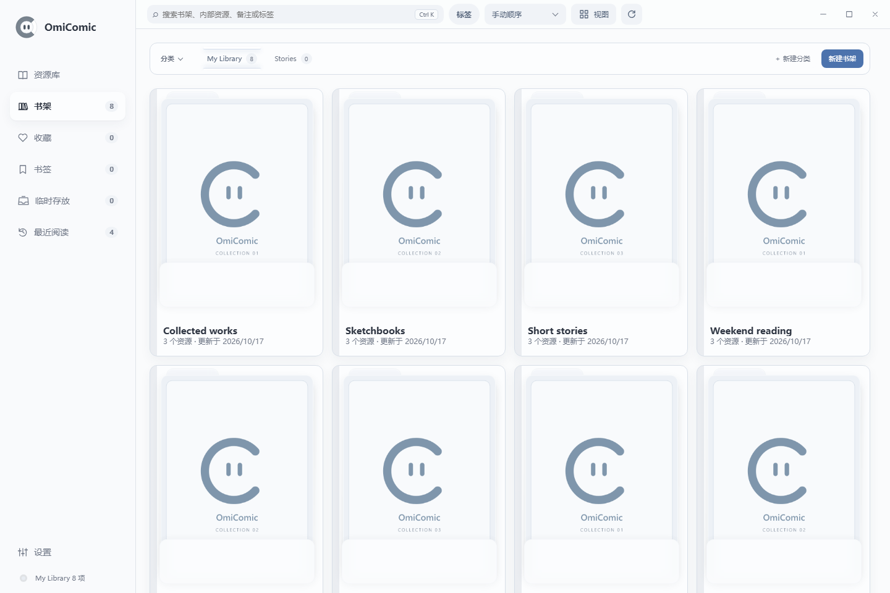</a>
</td>
<td width="50%" valign="top">
<h3>Reader</h3>

Read in double-page, fit-to-window, panorama or immersive mode. Jump with the progress rail and fine-tune brightness, contrast and image effects in real time.

<a href="docs/images/v1.1.36/windows-reader.png">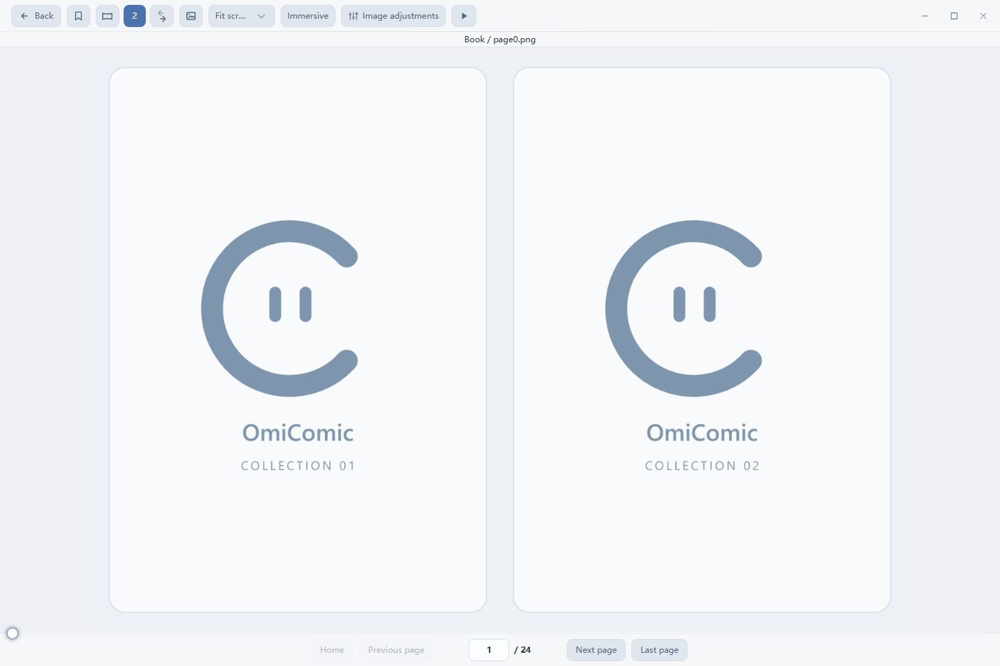</a>
</td>
</tr>
</table>

More about Windows: home, library, tags, details and settings

<table>
<tr>
<td width="50%" valign="top">
<h3>Home</h3>

Recent books display covers, page numbers and progress. Double-click a cover or click Continue reading on hover to resume.

<a href="docs/images/v1.1.40/windows-home.png">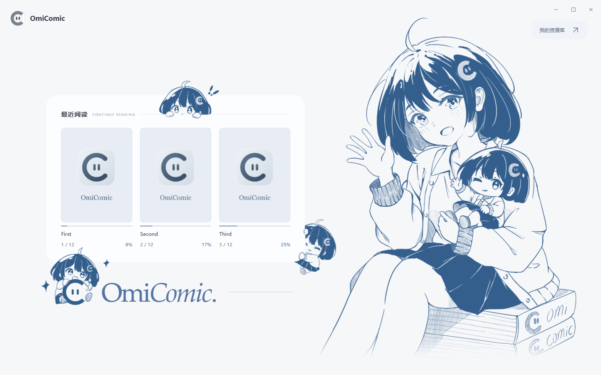</a>
</td>
<td width="50%" valign="top">
<h3>Library</h3>

Add multiple comic folders, browse as a cover grid or list, and locate books by name, tags or description.

<a href="docs/images/v1.1.36/windows-library.png">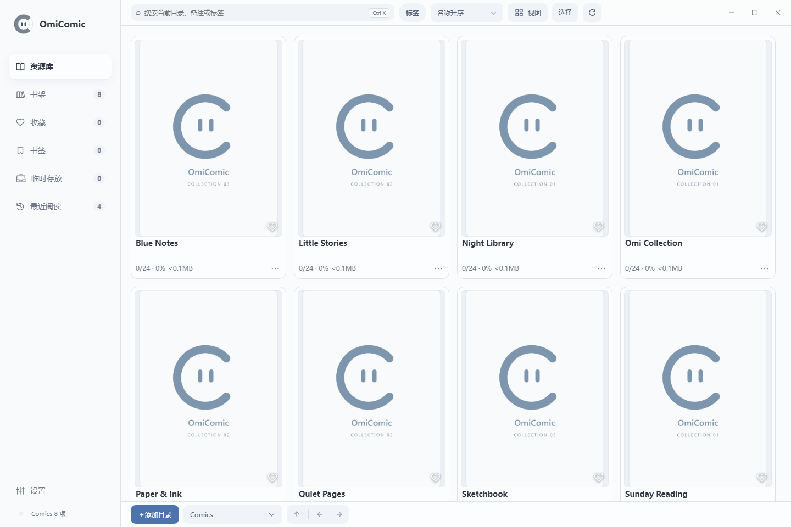</a>
</td>
</tr>
<tr>
<td width="50%" valign="top">
<h3>Tag filters</h3>

Filter tags with fuzzy or exact matching, and manage or clean up tags in the same panel.

<a href="docs/images/v1.1.36/windows-tags.png">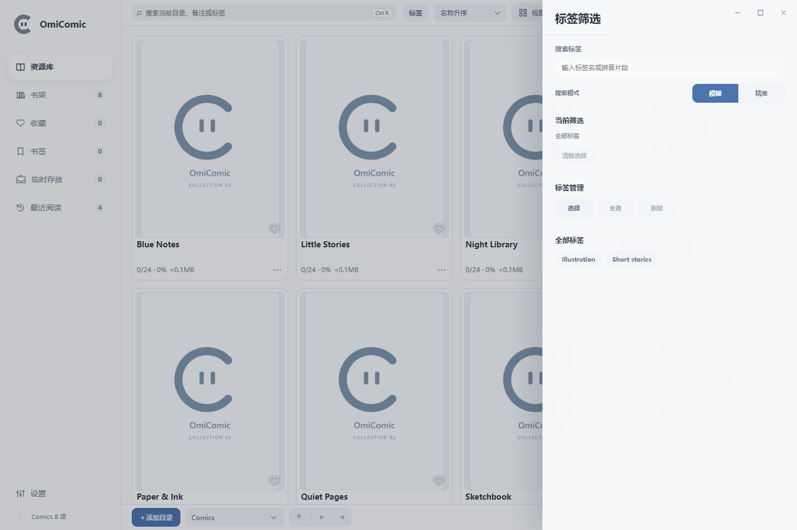</a>
</td>
<td width="50%" valign="top">
<h3>Comic details</h3>

View the cover, progress, tags, description and page thumbnails. Double-click the description to edit or a thumbnail to jump straight to that page.

<a href="docs/images/v1.1.36/windows-detail.png">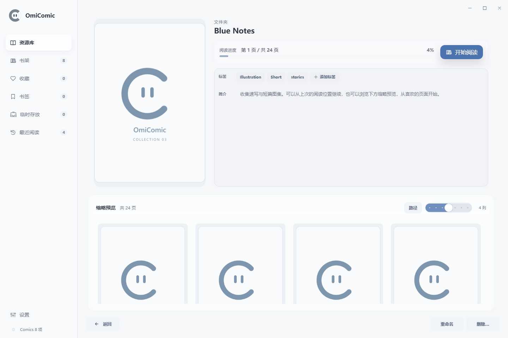</a>
</td>
</tr>
<tr>
<td width="50%" valign="top">
<h3>Settings</h3>

Customize themes, text size, reading preferences, image caching and preloading, with optional system theme following.

<a href="docs/images/v1.1.36/windows-settings.png">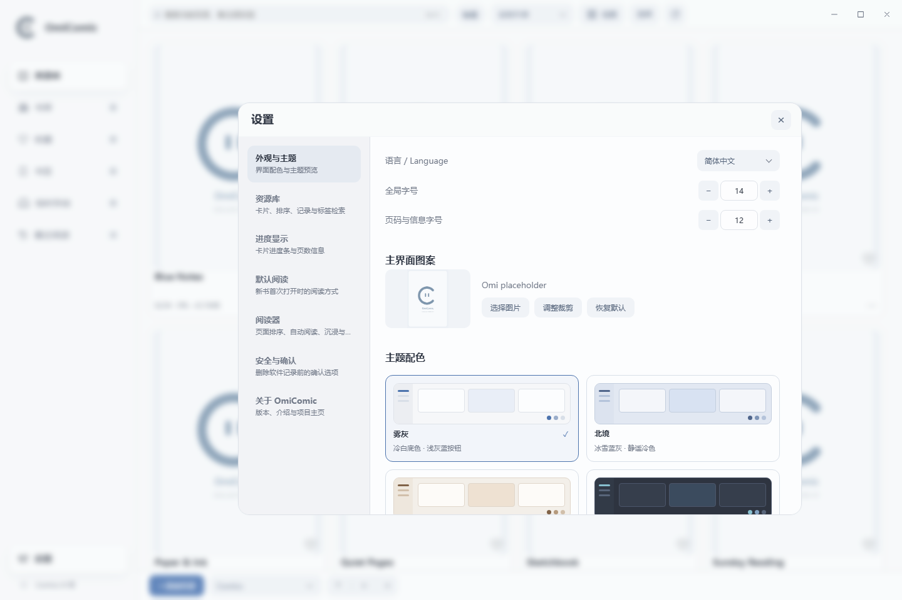</a>
</td>
<td width="50%" valign="top">
<h3>About OmiComic</h3>

Check the current version, project homepage and built-in guide with collapsible sections and offline search.

</td>
</tr>
</table>

## macOS

Shares the full Windows format support, library management and reading tools, paired with native window controls, Command shortcuts (`⌘ + K` search, `⌘ + wheel` zoom) and Dock reopening after closing the window.

Unzip the archive and drag OmiComic into Applications; see the [Mac installation guide](docs/APPLE.md) or the in-app guide for first-launch instructions and shortcuts.

## Android

Designed around touch controls, moving smoothly from folder browsing to full-screen reading with one hand.

<table>
<tr>
<td width="50%" valign="top">
<h3>Bookshelves</h3>

Group comics by reading plans, long-press to select or reorder items, and organize shelves with categories.

<a href="docs/images/v1.1.36/android-shelves.png">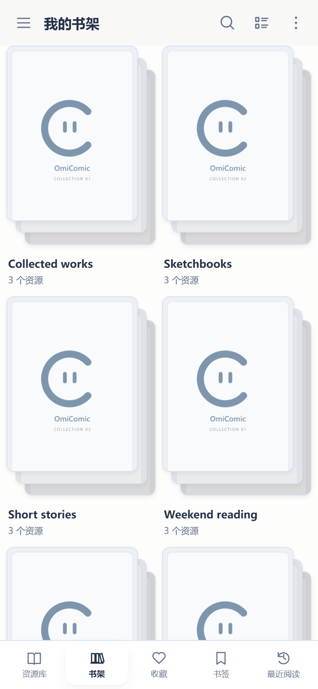</a>

</td>
<td width="50%" valign="top">
<h3>Reader</h3>

Tap the center to reveal controls. Turn pages with swipes or volume keys, pinch to zoom, or use auto reading.

<a href="docs/images/v1.1.36/android-reader.png">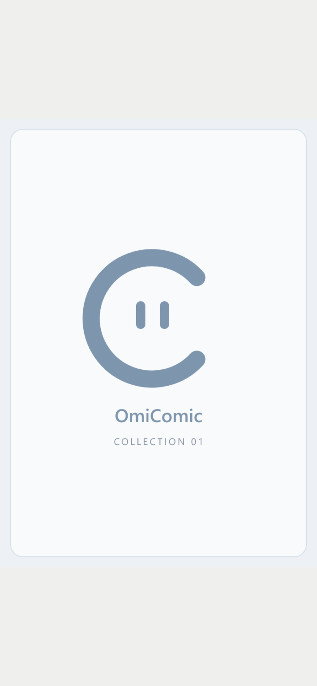</a>

</td>
</tr>
</table>

More about Android: home, library, folders, details and settings

<table>
<tr>
<td width="50%" valign="top">
<h3>Home</h3>

Recent books show covers and progress—tap to resume, or switch to the library and settings from the bottom bar.

<a href="docs/images/v1.1.36/android-home.png">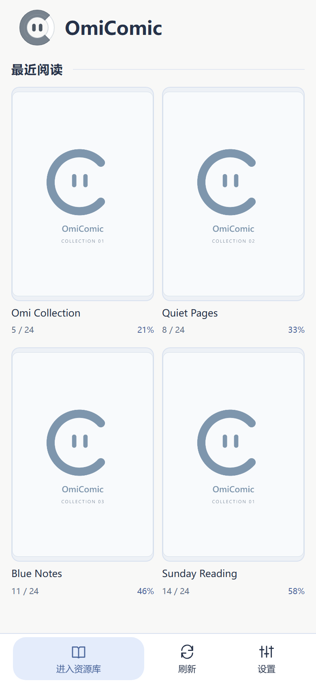</a>

</td>
<td width="50%" valign="top">
<h3>Library</h3>

Switch between Library, Shelves, Favorites, Bookmarks and Recent, with independent grid or list layouts per view.

<a href="docs/images/v1.1.36/android-library.png">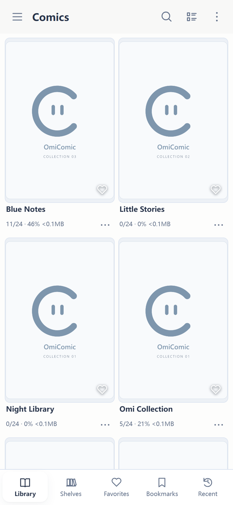</a>

</td>
</tr>
<tr>
<td width="50%" valign="top">
<h3>Folder browser</h3>

Navigate comic folders from the side drawer, add new folders or open an individual file anytime.

<a href="docs/images/v1.1.36/android-folders.png">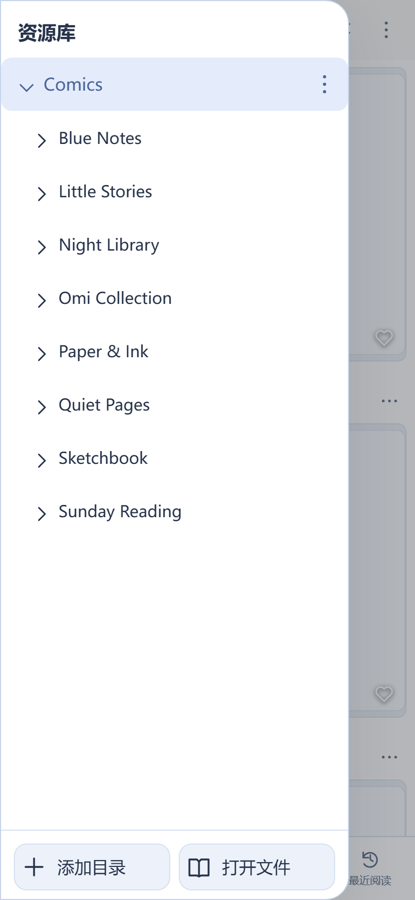</a>

</td>
<td width="50%" valign="top">
<h3>Comic details</h3>

View the cover, tags, description and page previews, and start reading from any page you want.

<a href="docs/images/v1.1.36/android-detail.png">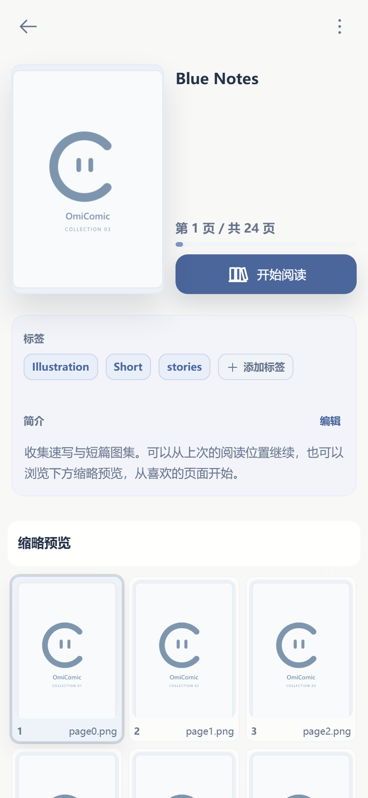</a>

</td>
</tr>
<tr>
<td width="50%" valign="top">
<h3>Settings</h3>

Keep separate layouts for each view, and customize language, theme, reading modes and cache size.

<a href="docs/images/v1.1.36/android-settings.png">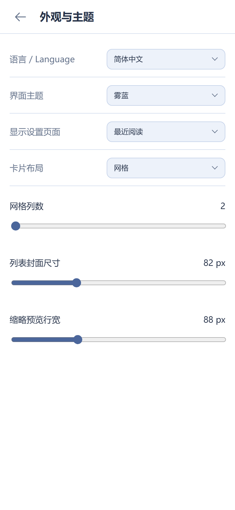</a>

</td>
<td width="50%" valign="top">
<h3>About OmiComic</h3>

View the app overview, current version and GitHub project page.

<a href="docs/images/v1.1.36/android-about.png">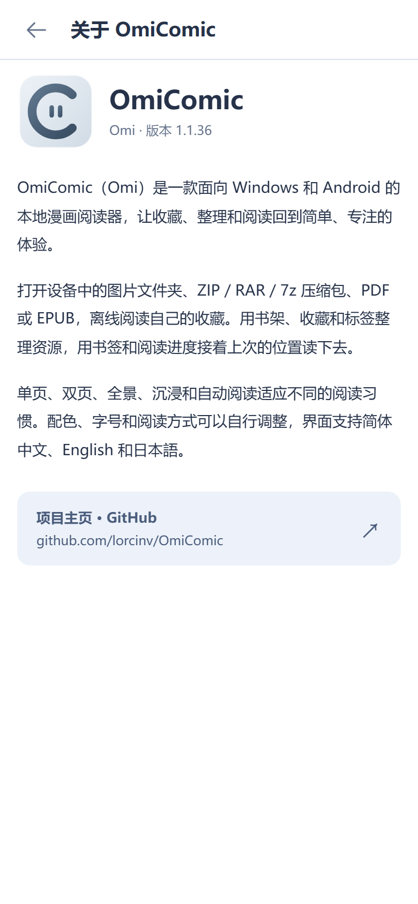</a>

</td>
</tr>
</table>

## [Support the author](docs/support.md)

If OmiComic has been helpful, you can support the authorヽ(✿ﾟ▽ﾟ)ノ

## More

[User guide](docs/USER_GUIDE.en.md) · [Changelog](CHANGELOG.md) · [Report an issue](https://github.com/lorcinv/OmiComic/issues) · [Previous releases](docs/releases/README.en.md)

## License

OmiComic's original program code is licensed under the **GNU General Public License version 3 only (GPL-3.0-only)**; see [LICENSE](LICENSE). Third-party components retain their own licenses. The source and licensing details for the earlier home illustration (removed in 1.1.40) are documented in [Asset credits](ASSET_CREDITS.md).
