[简体中文](README.md) · [English](README.en.md) · **日本語**

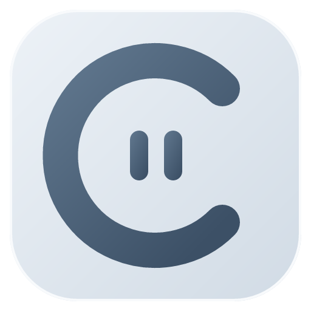

# OmiComic

**漫画を整理して、前回の続きから。**

OmiComic は、ローカルでの高速起動とすっきりした読書体験を重視した、Windows・Android 両対応の漫画リーダーです。画像、ZIP／CBZ、RAR／CBR、7z／CB7、PDF、EPUB、従来形式の DRM なし MOBI に対応し、本棚、カテゴリー、タグ、お気に入りでローカルの漫画を整理できます。

## [作者を応援する](docs/support.md)

OmiComic がお役に立ちましたら、作者を応援していただけるとうれしいですヽ(✿ﾟ▽ﾟ)ノ

## 紹介動画

https://github.com/user-attachments/assets/fd510975-c555-45ca-9d2b-286f09397135

[▶ Bilibili で紹介動画を見る（中国語）](https://www.bilibili.com/video/BV17QnU6sE2L/)

## ダウンロード

| 対応環境 | パッケージ |
| --- | --- |
| PC · Windows x64 | [OmiComic 1.1.55 · ZIP](https://github.com/lorcinv/OmiComic/releases/download/v1.1.55/OmiComic-Portable-1.1.55-x64.zip) · [Setup EXE](https://github.com/lorcinv/OmiComic/releases/download/v1.1.55/OmiComic-Setup-1.1.55-x64.exe) |
| Android 8.0+ | [OmiComic 1.1.55 · APK](https://github.com/lorcinv/OmiComic/releases/download/v1.1.55/OmiComic-1.1.55-android.apk) |

Windows：ZIP をすべて展開し、<code>OmiComic.exe</code> を起動します。 Android：APK をインストールして、既存のアプリを更新できます。

1.1.55 は 1.1.50–1.1.55 の読書改善をまとめ、PC 横向きのクリック範囲、両環境のズーム復元、スマートフォンのドラッグ、PC のページ応答を改善しました。操作ガイドにも追加機能を反映しています。[バージョン別更新内容](docs/releases/v1.1.55.md)。

## 機能

- 画像フォルダー、単一画像、ZIP／CBZ、RAR／CBR、7z／CB7、PDF、EPUB、従来形式の DRM なし MOBI に対応。
- 本棚、カテゴリー、タグ、お気に入り、検索で整理。気になるページにはしおりを残せます。
- 単ページ、見開き、パノラマ、没入、自動読書から読み方を選択。
- 読書進捗を自動保存し、ホーム画面からすぐに再開。
- 霧グレー、北欧、暖砂、夜色のテーマを用意。UI は簡体字中国語、英語、日本語に対応。

## Windows 版

マウスとキーボードで、漫画の閲覧からコレクションの整理まで操作できます。

<table>
<tr>
<td width="50%" valign="top">
<h3>ホーム</h3>

最近読んだ作品の表紙、ページ番号、進捗を表示。表紙をダブルクリックするか、ホバー時の「続きを読む」で再開できます。

<a href="docs/images/v1.1.40/windows-home.png">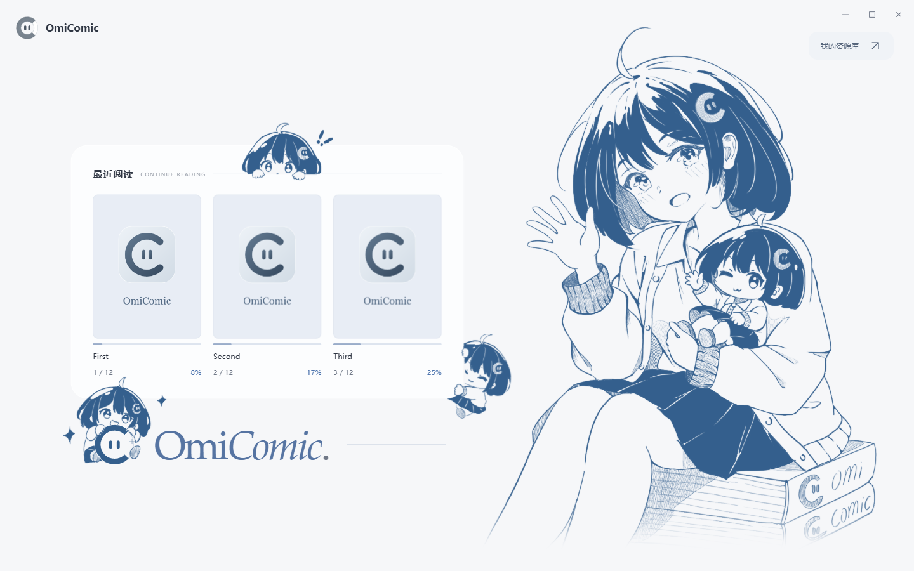</a>
</td>
<td width="50%" valign="top">
<h3>ライブラリ</h3>

複数の漫画フォルダーを追加し、表紙グリッドやリストで閲覧。名前、タグ、紹介文から作品を探せます。

<a href="docs/images/v1.1.36/windows-library.png">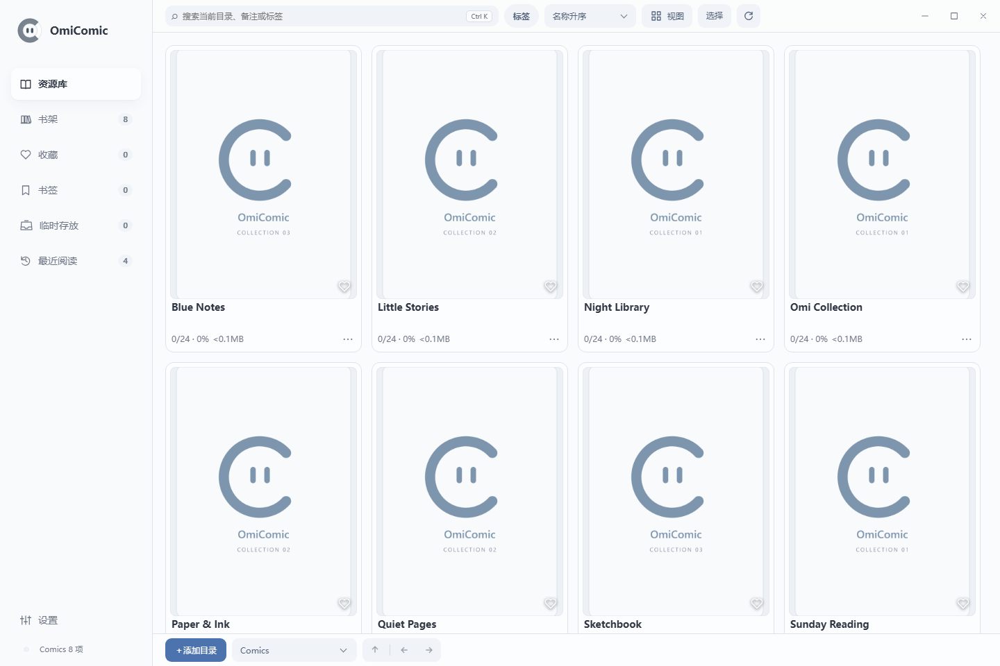</a>
</td>
</tr>
<tr>
<td width="50%" valign="top">
<h3>本棚</h3>

シリーズ、作者、読書予定に合わせて本棚を作り、カテゴリーで整理。マウスの中ボタンでカードをドラッグして並べ替えられます。

<a href="docs/images/v1.1.36/windows-shelves.png">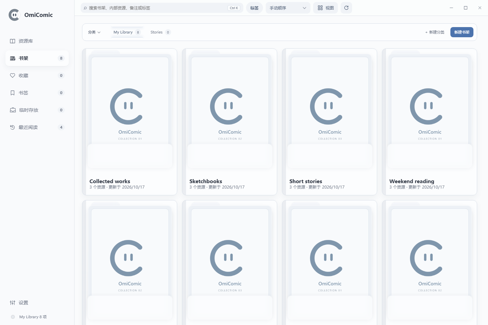</a>
</td>
<td width="50%" valign="top">
<h3>タグの絞り込み</h3>

あいまい一致や完全一致でタグを絞り込み、同じパネルでタグを管理・削除できます。

<a href="docs/images/v1.1.36/windows-tags.png">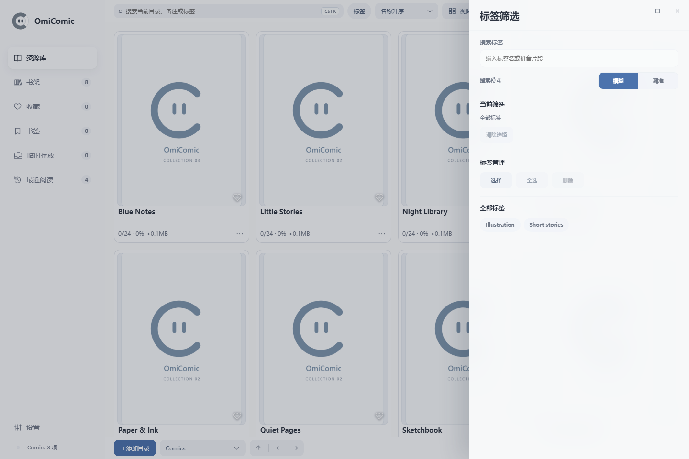</a>
</td>
</tr>
<tr>
<td width="50%" valign="top">
<h3>作品詳細とページプレビュー</h3>

表紙、進捗、タグ、紹介文、ページ一覧を確認。紹介文はダブルクリックで編集でき、サムネイルをダブルクリックするとそのページから読めます。

<a href="docs/images/v1.1.36/windows-detail.png">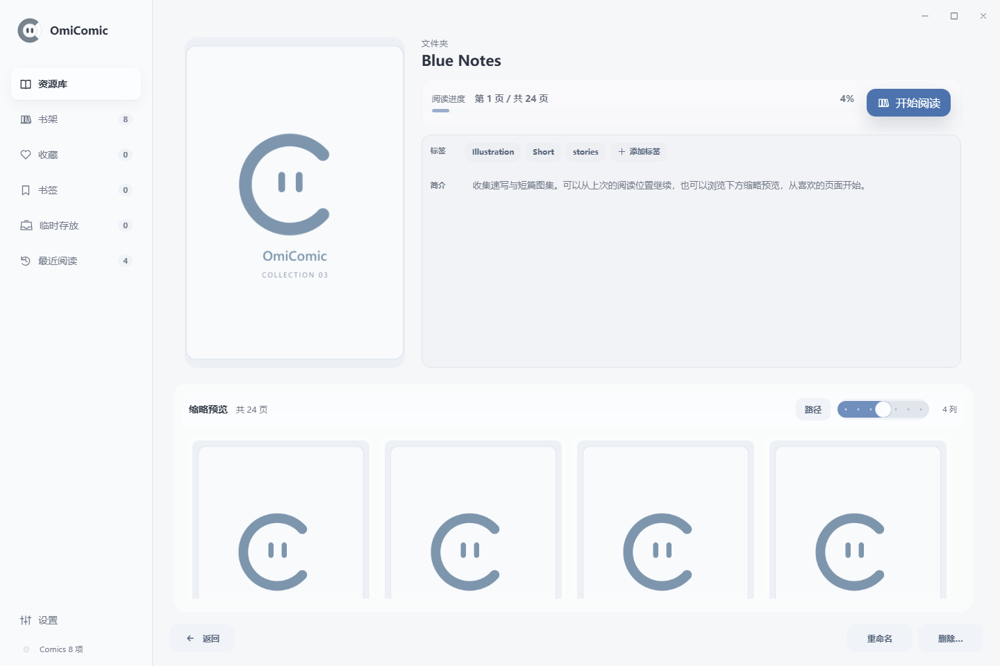</a>
</td>
<td width="50%" valign="top">
<h3>リーダー</h3>

見開き、ウィンドウに合わせる表示、パノラマ、没入モードに対応。進捗バーで移動し、明るさ・コントラスト・画像効果をすぐに調整できます。

<a href="docs/images/v1.1.36/windows-reader.png">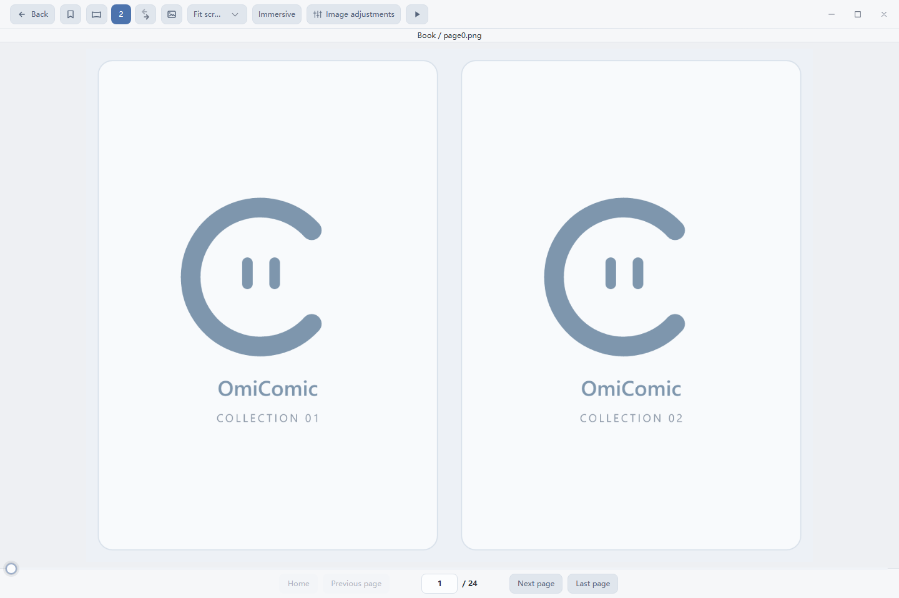</a>
</td>
</tr>
<tr>
<td width="50%" valign="top">
<h3>設定</h3>

テーマ、文字サイズ、ホーム画像、読み方、画像キャッシュ、先読みを調整。ホーム画像はプレビューを見ながらトリミングできます。

<a href="docs/images/v1.1.36/windows-settings.png">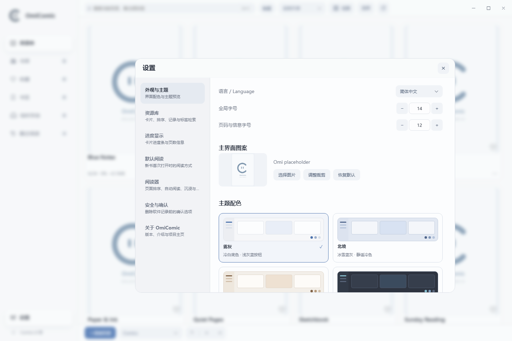</a>
</td>
<td width="50%" valign="top">
<h3>OmiComic について</h3>

アプリの紹介、現在のバージョン、GitHub のプロジェクトを確認できます。

<a href="docs/images/v1.1.40/windows-about.png">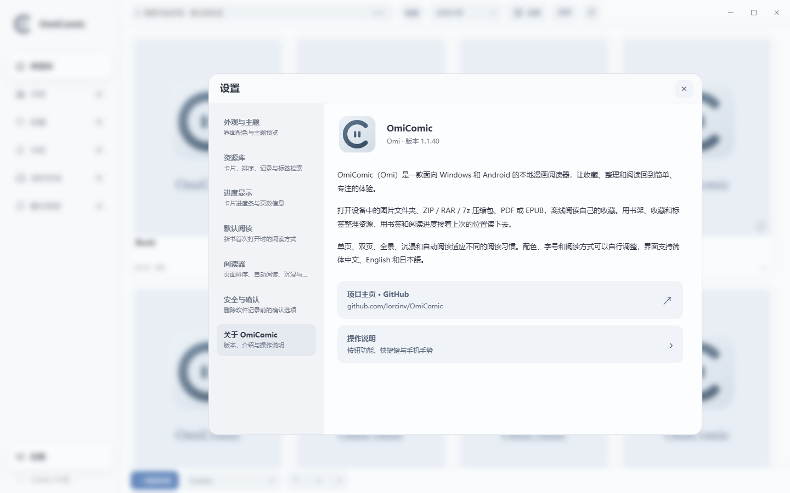</a>
</td>
</tr>
</table>

## Android 版

タッチ操作に合わせた画面で、フォルダーの閲覧から全画面の読書へスムーズに切り替えられます。

<table>
<tr>
<td width="50%" valign="top">
<h3>ホーム</h3>

最近の作品の表紙と進捗を表示し、タップで再開。下部からライブラリや設定を開けます。

<a href="docs/images/v1.1.36/android-home.png">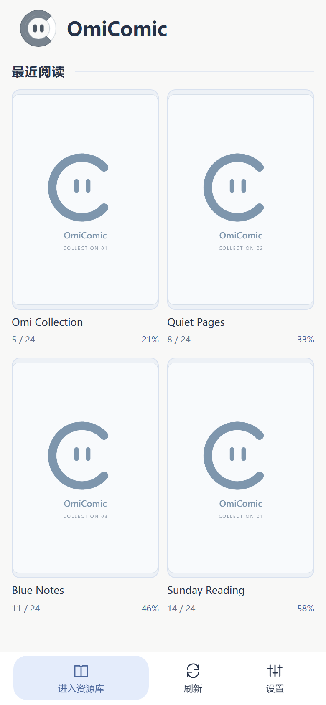</a>
</td>
<td width="50%" valign="top">
<h3>ライブラリ</h3>

下部でライブラリ、本棚、お気に入り、しおり、履歴を切り替え。各画面でグリッドとリストを個別に設定できます。

<a href="docs/images/v1.1.36/android-library.png">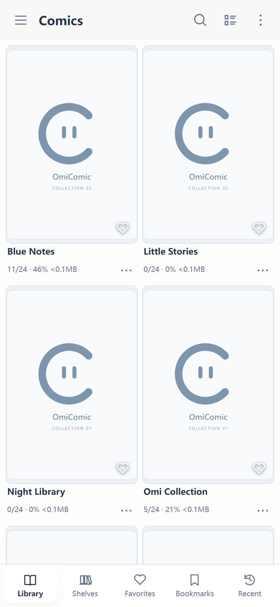</a>
</td>
</tr>
<tr>
<td width="50%" valign="top">
<h3>フォルダーの閲覧</h3>

サイドメニューのフォルダーツリーから漫画を探し、フォルダーの追加や単一ファイルの読み込みも行えます。

<a href="docs/images/v1.1.36/android-folders.png">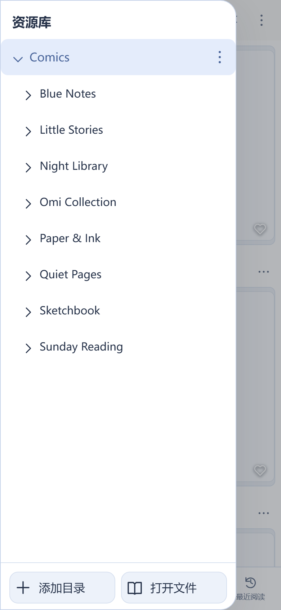</a>
</td>
<td width="50%" valign="top">
<h3>本棚</h3>

読書予定に合わせて作品を本棚にまとめられます。長押しで選択・並べ替えを行い、カテゴリーで整理できます。

<a href="docs/images/v1.1.36/android-shelves.png">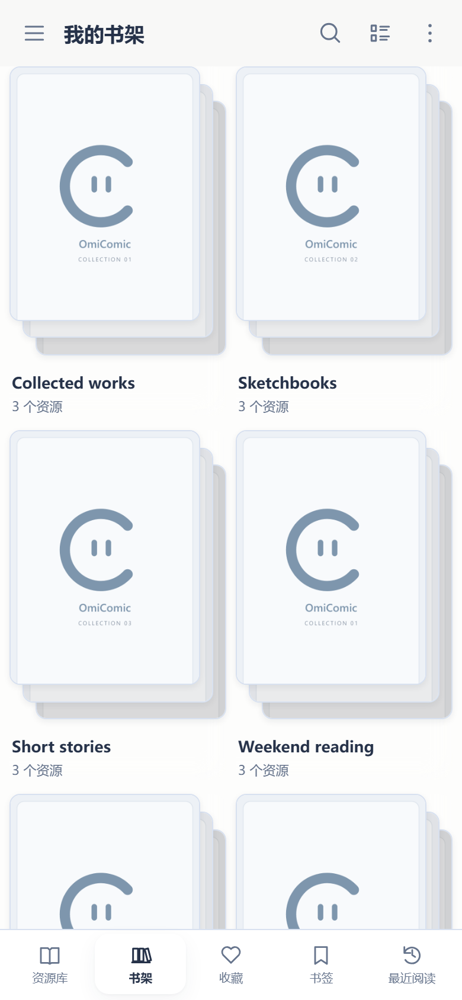</a>
</td>
</tr>
<tr>
<td width="50%" valign="top">
<h3>作品詳細</h3>

表紙、タグ、紹介文、ページプレビューを確認して、読みたいページから開けます。

<a href="docs/images/v1.1.36/android-detail.png">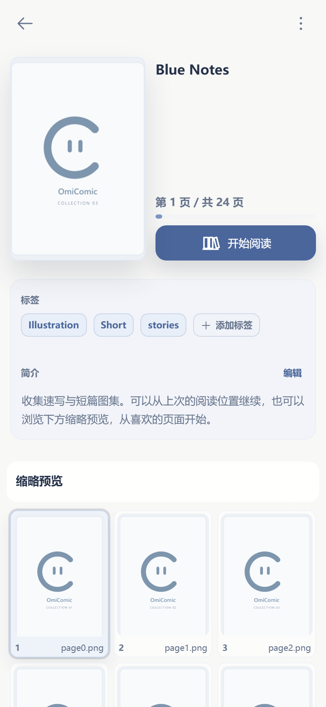</a>
</td>
<td width="50%" valign="top">
<h3>リーダー</h3>

画面中央をタップすると読書ツールを表示。スワイプや音量キーでページを送り、ピンチで拡大し、自動読書も使えます。

<a href="docs/images/v1.1.36/android-reader.png">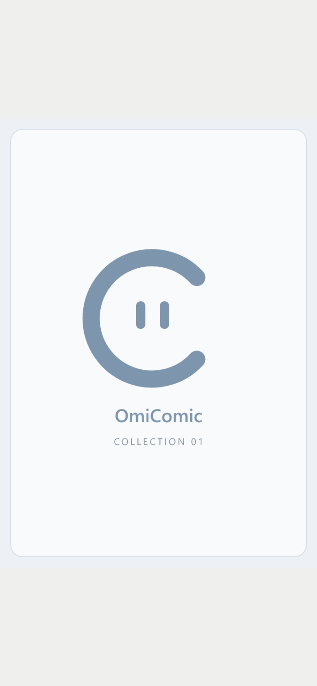</a>
</td>
</tr>
<tr>
<td width="50%" valign="top">
<h3>設定</h3>

画面ごとに表示レイアウトを保存し、言語、テーマ、読み方、キャッシュ容量を調整できます。

<a href="docs/images/v1.1.36/android-settings.png">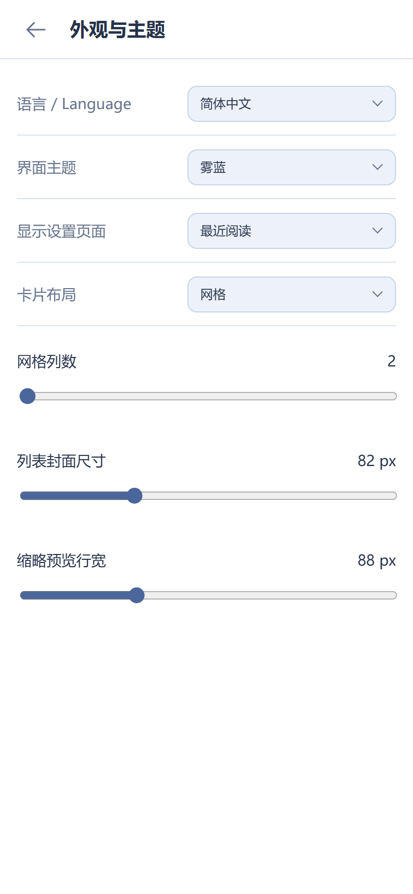</a>
</td>
<td width="50%" valign="top">
<h3>OmiComic について</h3>

アプリの紹介、バージョン、GitHub のプロジェクトを確認できます。

<a href="docs/images/v1.1.36/android-about.png">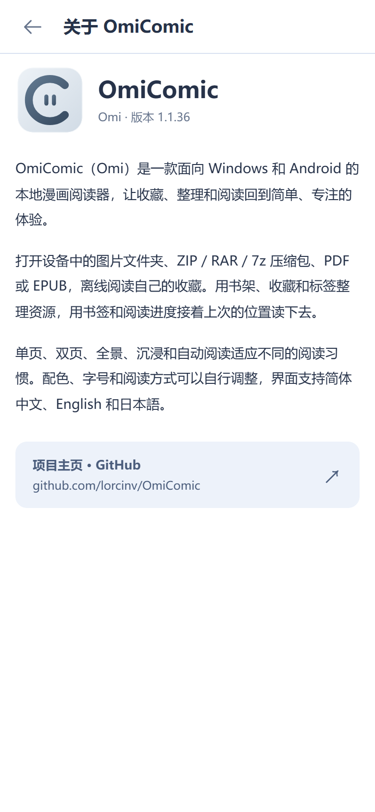</a>
</td>
</tr>
</table>

## 関連リンク

[使い方](docs/USER_GUIDE.ja.md) · [更新履歴](CHANGELOG.md) · [不具合の報告](https://github.com/lorcinv/OmiComic/issues) · [過去のリリース](docs/releases/README.ja.md)

## ライセンス

OmiComic 独自のプログラムコードは **GNU General Public License バージョン 3 のみ（GPL-3.0-only）** で公開されています。詳細は [LICENSE](LICENSE) をご覧ください。第三者のコンポーネントはそれぞれのライセンスに従います。旧版ホーム画面イラストの出典と未確認の権利は [素材の出典](ASSET_CREDITS.md) に記載しています。1.1.40 から旧画像は含まれません。
