

  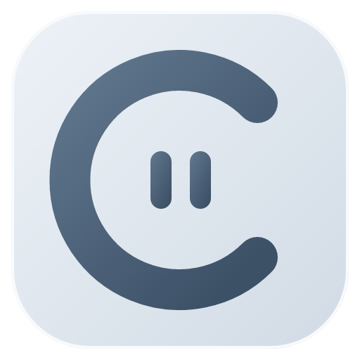
  <h1>OmiComic</h1>
  
<strong>漫画を整理して、前回の続きから。</strong>

  
<a href="README.md">简体中文</a> · <a href="README.en.md">English</a> · <strong>日本語</strong>

  

    
    
    
    
  

  
<em>役に立ったら、STAR をお願いします (☆ ω ☆)</em>

  
<a href="#ダウンロード">ダウンロード</a> · <a href="#紹介動画">紹介動画</a> · <a href="#機能">機能</a> · <a href="docs/support.md">作者を応援する</a>

 

OmiComic は、高速起動とすっきりした読書体験を重視した Windows・macOS・Android 対応のローカル漫画リーダーです。手元の漫画を手軽に整理し、いつでも前回の続きから読み始められます。

## ダウンロード

Windows・macOS・Android の最新版は **1.2.6** です。

| 対応環境 | パッケージ |
| --- | --- |
| Windows x64 | [インストーラー版 · EXE](https://github.com/lorcinv/OmiComic/releases/download/v1.2.6/OmiComic-Setup-1.2.6-x64.exe) · [ポータブル版 · ZIP](https://github.com/lorcinv/OmiComic/releases/download/v1.2.6/OmiComic-Portable-1.2.6-x64.zip) |
| Android 8.0+ | [OmiComic 1.2.6 · APK](https://github.com/lorcinv/OmiComic/releases/download/v1.2.6/OmiComic-1.2.6-android.apk) |
| macOS · Apple Silicon（M シリーズ、arm64） | [ZIP](https://github.com/lorcinv/OmiComic/releases/download/v1.2.6/OmiComic-1.2.6-mac-arm64.zip) |
| macOS · Intel（x64） | [ZIP](https://github.com/lorcinv/OmiComic/releases/download/v1.2.6/OmiComic-1.2.6-mac-x64.zip) |

- **Windows**：インストーラー版は EXE を実行して導入します。ポータブル版は ZIP をすべて展開し、`OmiComic.exe` を起動します。
- **Android**：APK をインストールすると、そのまま上書き更新できます。
- **macOS**：M シリーズは Apple Silicon、Intel プロセッサーは Intel を選びます（[バージョンの選び方](docs/APPLE.md#mac-download)）。配布版は未署名・未公証のため、初回起動は [インストール案内](docs/APPLE.md#mac-install) をご確認ください。

> [!TIP]
> **1.2.6 の主な更新**：リーダーに「章」目次を追加（圧縮ファイルの章フォルダー、PDF しおり、EPUB 目次に対応）。サイドバー操作の改善と、Android のアンインストール時データ保持にも対応しました。[更新内容](docs/releases/v1.2.6.md) · [バージョン履歴](docs/releases/README.ja.md)

## 紹介動画

https://github.com/user-attachments/assets/fd510975-c555-45ca-9d2b-286f09397135

[▶ Bilibili で紹介動画を見る（中国語）](https://www.bilibili.com/video/BV17QnU6sE2L/)

## 機能

- **幅広いローカル形式に対応**：画像フォルダー、単一画像、ZIP/CBZ、RAR/CBR、7z/CB7、PDF、EPUB、DRM なし MOBI を直接開け、GIF・アニメーション WebP・APNG の再生にも対応。
- **手軽にライブラリ整理**：本棚、カテゴリー、タグ、お気に入り、しおりで作品を管理し、タイトル・タグ・紹介文から素早く検索。
- **自在な読書スタイル**：単ページ、見開き、パノラマ、没入、自動読書に加え、見開き分割、章目次ジャンプ、明るさ・コントラストなどの画質調整に対応。
- **続きからすぐ再開、データも安心**：読書進捗を自動保存してホームからすぐ再開。JSON バックアップの書き出し・読み込みにも対応。
- **テーマと多言語 UI**：霧グレー、北欧、暖砂、夜色の 4 テーマ（システムのライト／ダーク追従可）と、簡体字中国語・英語・日本語の UI を収録。

## Windows 版

マウスとキーボードの操作に合わせ、閲覧からコレクション整理まで快適にこなせます。

<table>
<tr>
<td width="50%" valign="top">
<h3>本棚</h3>

シリーズ、作者、読書予定に合わせて本棚を作成しカテゴリーで整理。マウス中ボタンのドラッグで並べ替えられます。

<a href="docs/images/v1.1.36/windows-shelves.png">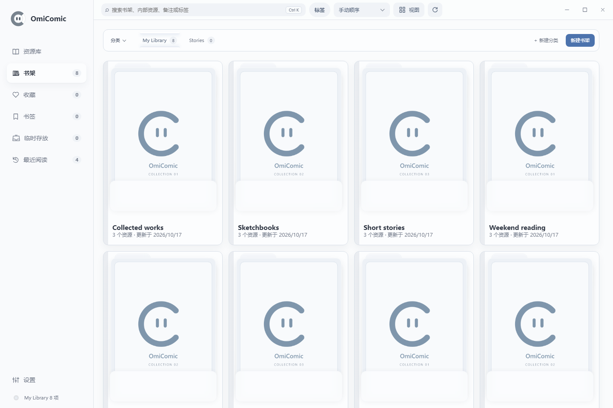</a>
</td>
<td width="50%" valign="top">
<h3>リーダー</h3>

見開き、ウィンドウに合わせる表示、パノラマ、没入モードに対応。進捗バーで移動し、明るさやコントラストをリアルタイムに調整できます。

<a href="docs/images/v1.1.36/windows-reader.png">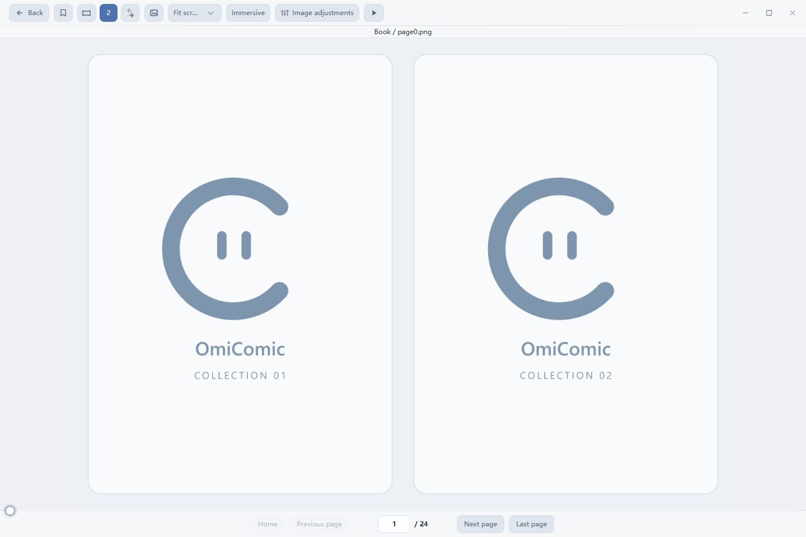</a>
</td>
</tr>
</table>

Windows の詳細：ホーム、ライブラリ、タグ、作品詳細、設定

<table>
<tr>
<td width="50%" valign="top">
<h3>ホーム</h3>

最近読んだ作品の表紙、ページ番号、進捗を表示。表紙をダブルクリックするか、ホバー時の「続きを読む」で再開できます。

<a href="docs/images/v1.1.40/windows-home.png">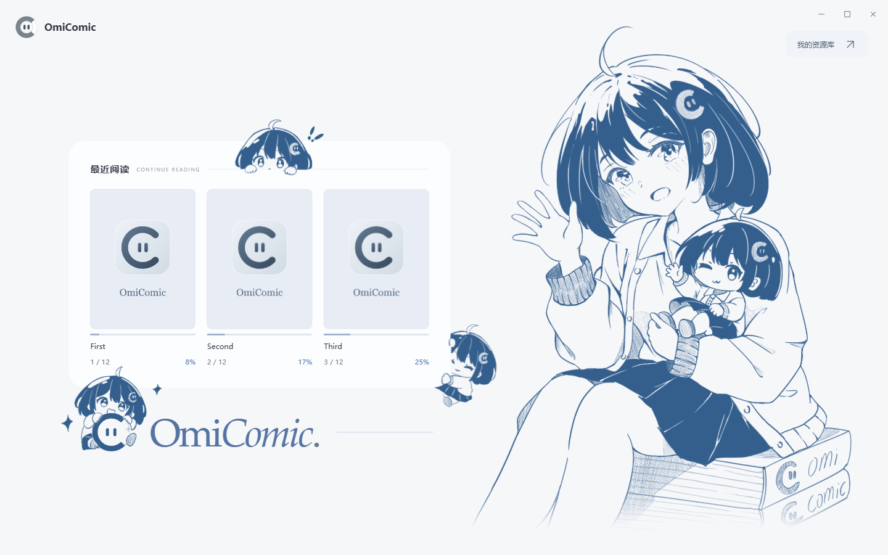</a>
</td>
<td width="50%" valign="top">
<h3>ライブラリ</h3>

複数の漫画フォルダーを追加し、表紙グリッドやリストで閲覧。名前、タグ、紹介文から作品を探せます。

<a href="docs/images/v1.1.36/windows-library.png">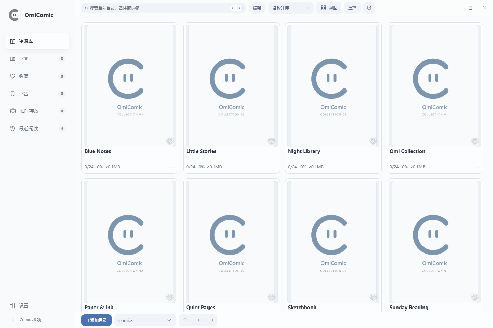</a>
</td>
</tr>
<tr>
<td width="50%" valign="top">
<h3>タグの絞り込み</h3>

あいまい一致や完全一致でタグを絞り込み、同じパネルでタグを管理・削除できます。

<a href="docs/images/v1.1.36/windows-tags.png">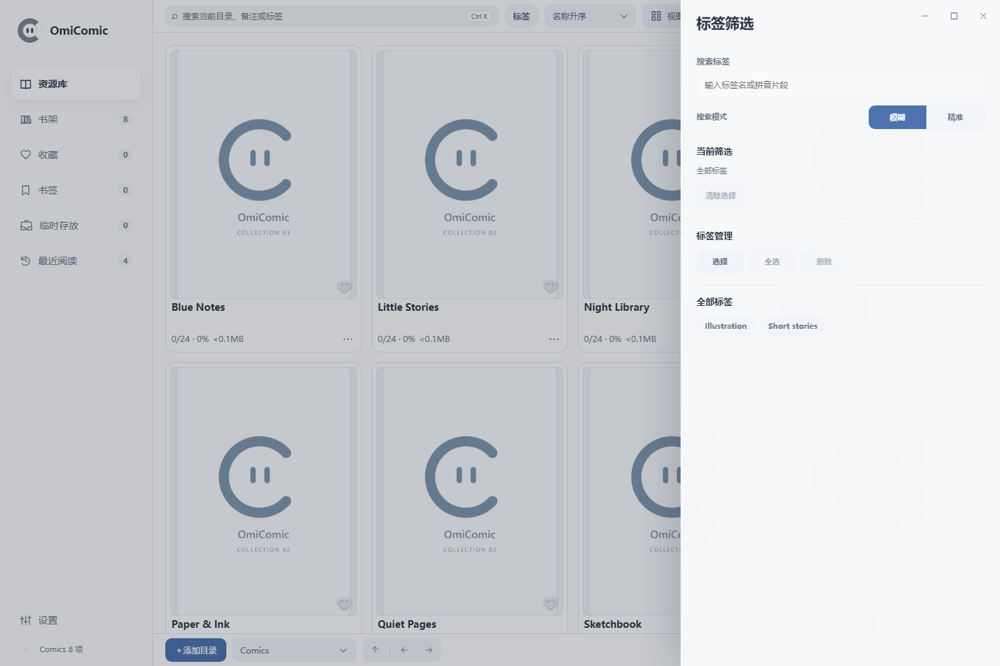</a>
</td>
<td width="50%" valign="top">
<h3>作品詳細</h3>

表紙、進捗、タグ、紹介文、ページサムネイルを確認。紹介文のダブルクリック編集や、サムネイルからの直接ジャンプに対応します。

<a href="docs/images/v1.1.36/windows-detail.png">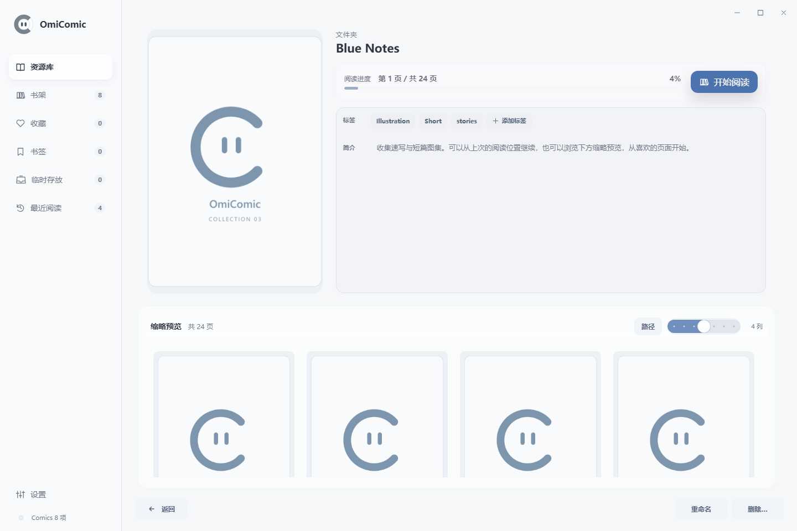</a>
</td>
</tr>
<tr>
<td width="50%" valign="top">
<h3>設定</h3>

テーマ、文字サイズ、読み方、画像キャッシュ、先読みを調整でき、システムテーマへの追従にも対応します。

<a href="docs/images/v1.1.36/windows-settings.png">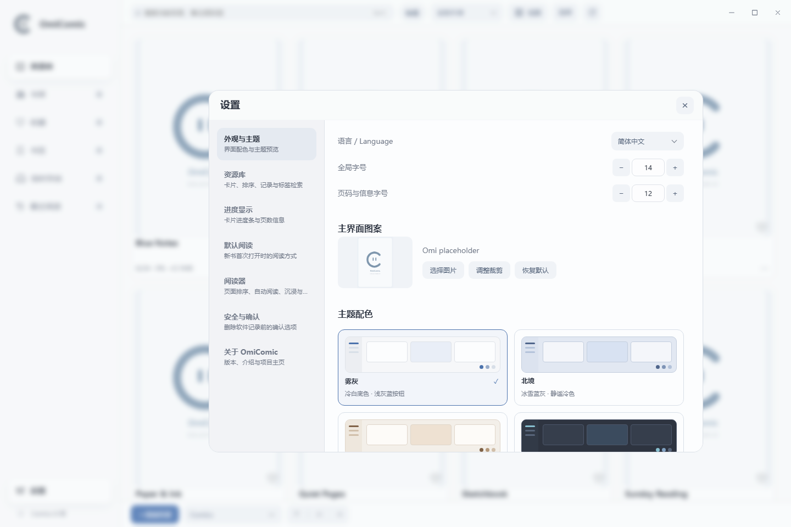</a>
</td>
<td width="50%" valign="top">
<h3>OmiComic について</h3>

現在のバージョン、GitHub プロジェクト、オフライン検索対応のアプリ内ガイドを確認できます。

<a href="docs/images/v1.1.40/windows-about.png">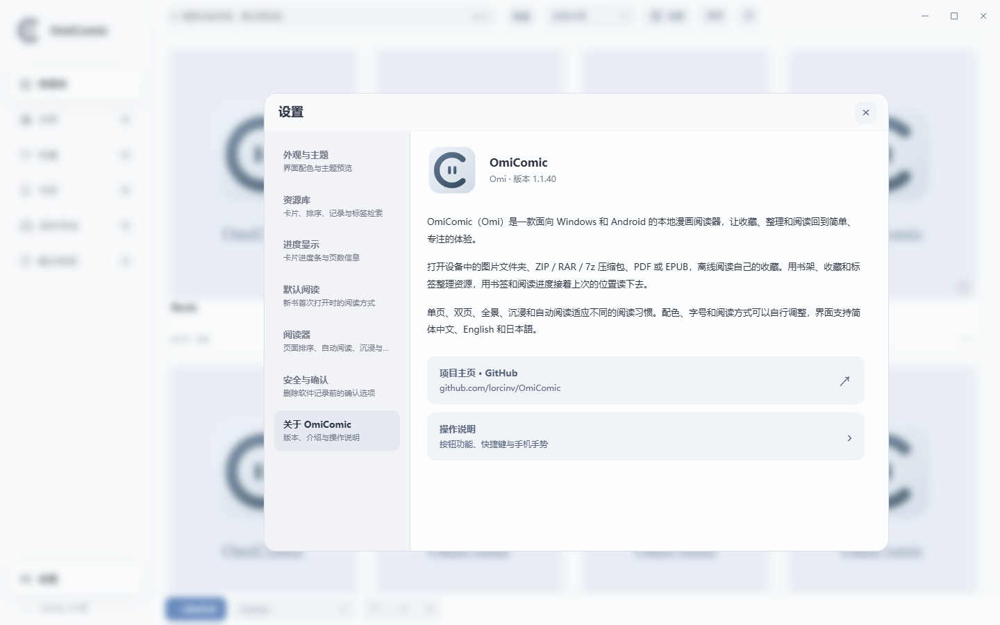</a>
</td>
</tr>
</table>

## macOS 版

Windows 版と同等の対応形式・本棚・読書ツールに加え、標準ウィンドウボタン、Command ショートカット（`⌘ + K` 検索、`⌘ + ホイール` 拡大縮小）、ウィンドウを閉じた後の Dock からの再表示に対応します。

ZIP を展開して OmiComic を「アプリケーション」へ移動するだけで利用できます。初回起動の手順や操作一覧は [Mac インストール案内](docs/APPLE.md) またはアプリ内ガイドをご覧ください。

## Android 版

タッチ操作に合わせて設計され、フォルダー閲覧から全画面読書まで片手でもスムーズに切り替えられます。

<table>
<tr>
<td width="50%" valign="top">
<h3>本棚</h3>

読書予定に合わせて作品を本棚にまとめ、長押しで選択・並べ替え、カテゴリーで整理できます。

<a href="docs/images/v1.1.36/android-shelves.png">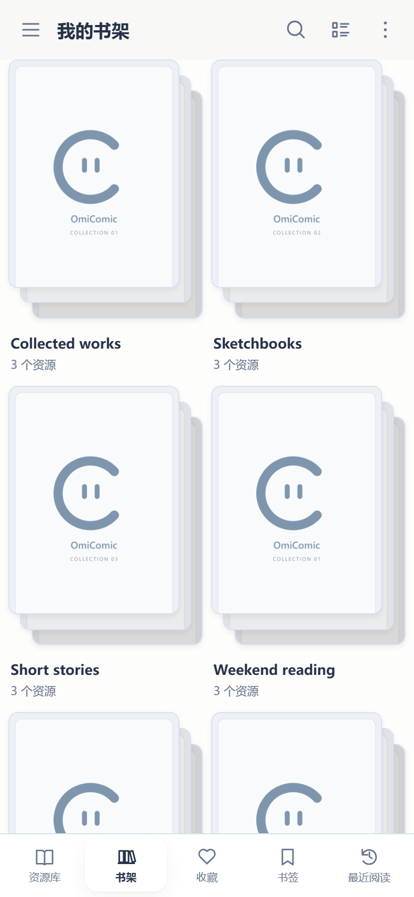</a>

</td>
<td width="50%" valign="top">
<h3>リーダー</h3>

画面中央をタップしてツールを表示。スワイプや音量キーでのページ送り、ピンチ拡大、自動読書が使えます。

<a href="docs/images/v1.1.36/android-reader.png">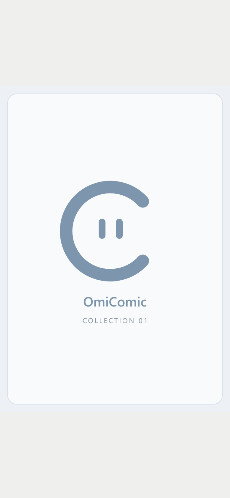</a>

</td>
</tr>
</table>

Android の詳細：ホーム、ライブラリ、フォルダー、作品詳細、設定

<table>
<tr>
<td width="50%" valign="top">
<h3>ホーム</h3>

最近の作品の表紙と進捗を表示し、タップで再開。下部バーからライブラリや設定へ直接移動できます。

<a href="docs/images/v1.1.36/android-home.png">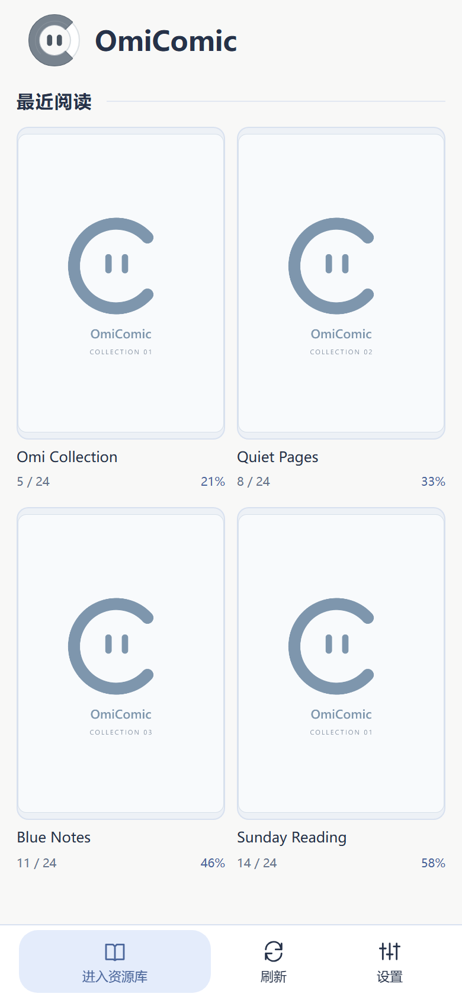</a>

</td>
<td width="50%" valign="top">
<h3>ライブラリ</h3>

下部バーでライブラリ、本棚、お気に入り、しおり、履歴を切り替え。各画面ごとにグリッド・リストを個別設定できます。

<a href="docs/images/v1.1.36/android-library.png">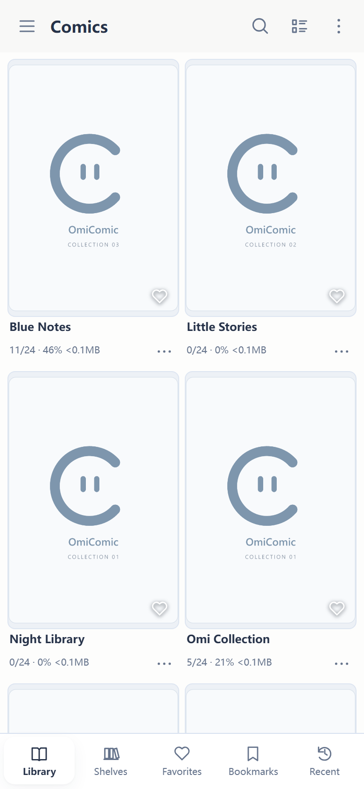</a>

</td>
</tr>
<tr>
<td width="50%" valign="top">
<h3>フォルダーの閲覧</h3>

サイドメニューのフォルダーツリーから漫画を探し、フォルダー追加や単一ファイルの読み込みも行えます。

<a href="docs/images/v1.1.36/android-folders.png">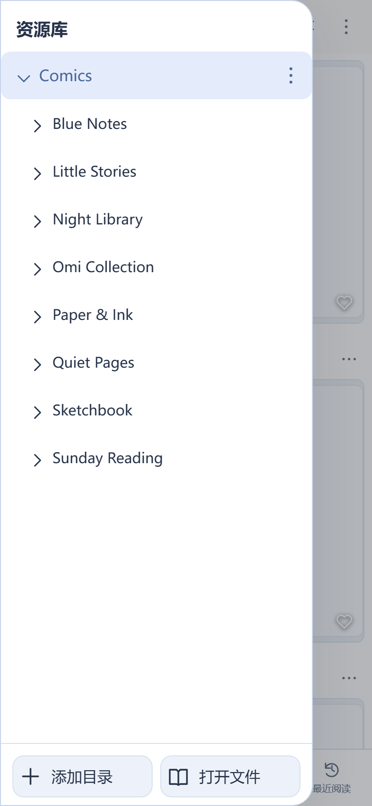</a>

</td>
<td width="50%" valign="top">
<h3>作品詳細</h3>

表紙、タグ、紹介文、ページプレビューを確認して、読みたいページから開けます。

<a href="docs/images/v1.1.36/android-detail.png">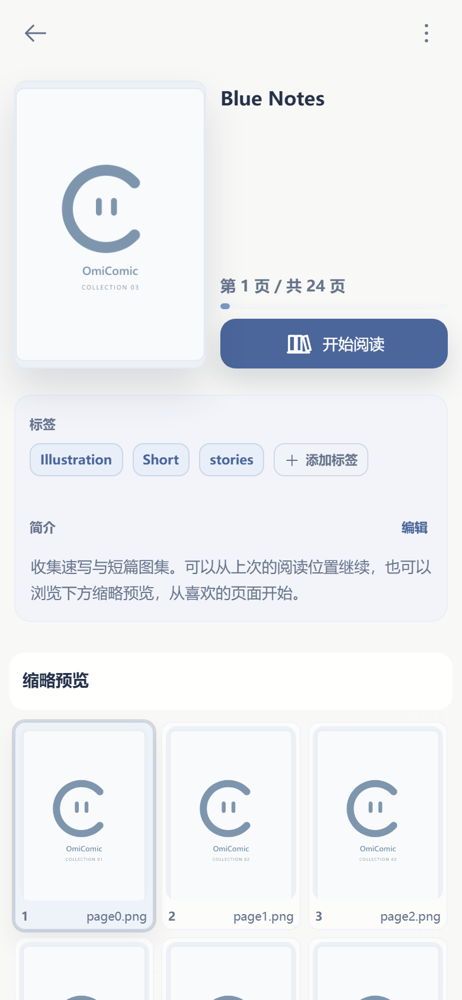</a>

</td>
</tr>
<tr>
<td width="50%" valign="top">
<h3>設定</h3>

画面ごとに表示レイアウトを保存し、言語、テーマ、読み方、キャッシュ容量を調整できます。

<a href="docs/images/v1.1.36/android-settings.png">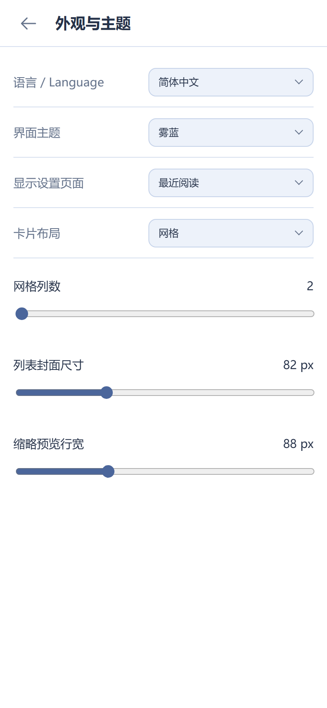</a>

</td>
<td width="50%" valign="top">
<h3>OmiComic について</h3>

アプリの紹介、現在のバージョン、GitHub プロジェクトを確認できます。

<a href="docs/images/v1.1.36/android-about.png">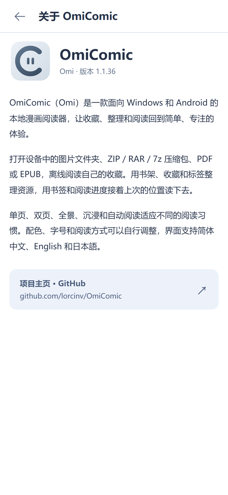</a>

</td>
</tr>
</table>

## [作者を応援する](docs/support.md)

OmiComic がお役に立ちましたら、作者を応援していただけるとうれしいですヽ(✿ﾟ▽ﾟ)ノ

## 関連リンク

[使い方](docs/USER_GUIDE.ja.md) · [更新履歴](CHANGELOG.md) · [不具合の報告](https://github.com/lorcinv/OmiComic/issues) · [過去のリリース](docs/releases/README.ja.md)

## ライセンス

OmiComic 独自のプログラムコードは **GNU General Public License バージョン 3 のみ（GPL-3.0-only）** で公開されています。詳細は [LICENSE](LICENSE) をご覧ください。第三者のコンポーネントはそれぞれのライセンスに従います。旧版ホーム画面イラスト（1.1.40 で削除済み）の出典と権利状況は [素材の出典](ASSET_CREDITS.md) に記載しています。
