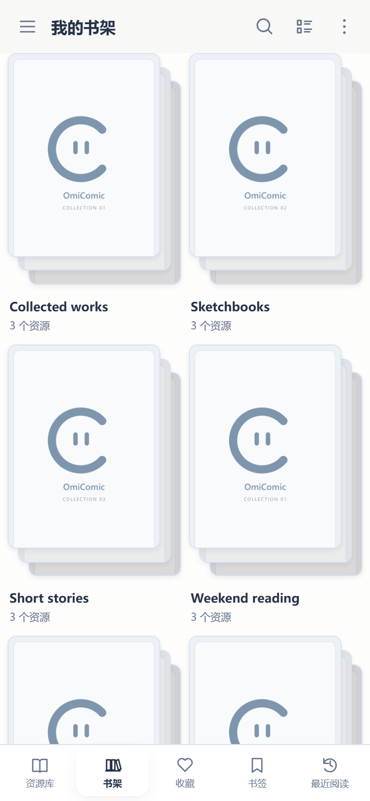
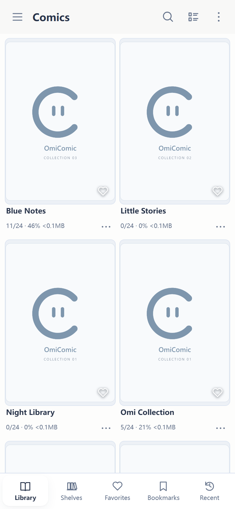

  
  <h1>OmiComic</h1>
  
<strong>整理你的漫画，享受沉浸阅读</strong>

  
<strong>简体中文</strong> · <a href="README.en.md">English</a> · <a href="README.ja.md">日本語</a>

  

    
    
    
    
  

  
<em>对你有帮助的话点个STAR吧(☆ ω ☆)</em>

  
<a href="#下载">下载</a> · <a href="#视频演示">视频演示</a> · <a href="#功能">功能</a> · <a href="docs/support.md">支持作者</a>

 

OmiComic 是一款面向 Windows、macOS、Android 的纯本地漫画阅读器，主打快速启动和纯净阅读，帮你顺手打理本地漫画书库，随时回到上次读到的那一页。

## 下载

Windows、macOS、Android 最新版均为 **1.2.7**。

| 平台 | 安装包 |
| --- | --- |
| Windows x64 | [安装版 · EXE](https://github.com/lorcinv/OmiComic/releases/download/v1.2.7/OmiComic-Setup-1.2.7-x64.exe) · [免安装版 · ZIP](https://github.com/lorcinv/OmiComic/releases/download/v1.2.7/OmiComic-Portable-1.2.7-x64.zip) |
| Android 8.0+ | [OmiComic 1.2.7 · APK](https://github.com/lorcinv/OmiComic/releases/download/v1.2.7/OmiComic-1.2.7-android.apk) |
| macOS · Apple Silicon（M 系列，arm64） | [ZIP](https://github.com/lorcinv/OmiComic/releases/download/v1.2.7/OmiComic-1.2.7-mac-arm64.zip) |
| macOS · Intel（x64） | [ZIP](https://github.com/lorcinv/OmiComic/releases/download/v1.2.7/OmiComic-1.2.7-mac-x64.zip) |

- **Windows**：安装版运行 EXE 按提示安装；免安装版完整解压后运行 `OmiComic.exe`。
- **Android**：安装 APK，可直接覆盖升级。
- **macOS**：M 系列选 Apple Silicon，Intel 芯片选 Intel（[如何选择版本](docs/APPLE.md#mac-download)）；安装包未签名和公证，首次打开见 [安装说明](docs/APPLE.md#mac-install)。

> [!TIP]
> **1.2.7 更新亮点**：普通图片文件夹可按中、日、英文文件名前缀分章，沿用原有翻页顺序。[本次更新](docs/releases/v1.2.7.md) · [试读样本](https://github.com/lorcinv/OmiComic/releases/download/v1.2.7/OmiComic-1.2.7-folder-chapter-demo.zip) · [版本记录](docs/releases/README.md)

## 视频演示

https://github.com/user-attachments/assets/fd510975-c555-45ca-9d2b-286f09397135

[▶ 在 B 站观看演示](https://www.bilibili.com/video/BV17QnU6sE2L/)

## 功能

- **全格式本地直读**：支持图片文件夹、单张图片、ZIP/CBZ、RAR/CBR、7z/CB7、PDF、EPUB、无 DRM 的 MOBI，支持 GIF、动态 WebP、APNG 原画播放。
- **顺手整理书库**：通过书架、分类、标签、收藏和书签管理本地漫画，支持按名称、标签或简介快速搜索。
- **自由切换阅读方式**：提供单页、双页、全景、沉浸和自动阅读，支持横页跨页拆分、章节目录跳转，以及亮度、对比度等画面微调。
- **断点续读、数据可控**：自动保存阅读进度，首页一键继续阅读；支持 JSON 备份导出恢复，重装或换设备不丢记录。
- **多主题、多语言**：内置雾灰、北境、暖沙、夜色四种主题（可选跟随系统浅色/深色），支持简体中文、English、日本語。

## Windows 版

围绕键鼠习惯设计的完整桌面书库，浏览、整理和阅读一气呵成。

<table>
<tr>
<td width="50%" valign="top">
<h3>书架</h3>

按系列、作者或阅读计划建立书架，用分类整理不同收藏；中键拖动卡片即可调整顺序。

</td>
<td width="50%" valign="top">
<h3>阅读器</h3>

支持双页、适应窗口、全景和沉浸阅读；通过底部进度条跳页，实时调整亮度、对比度和画面效果。

</td>
</tr>
</table>

展开 Windows 详细介绍：首页、资源库、标签、详情、设置

<table>
<tr>
<td width="50%" valign="top">
<h3>首页</h3>

最近阅读集中展示封面、页码和进度。双击封面，或点击悬停时出现的「继续阅读」，直接回到上次位置。

</td>
<td width="50%" valign="top">
<h3>资源库</h3>

添加多个漫画目录，按封面网格或列表浏览，通过名称、标签和简介快速定位资源。

</td>
</tr>
<tr>
<td width="50%" valign="top">
<h3>标签筛选</h3>

支持模糊或精准筛选标签，在同一面板里统一管理和清理。

</td>
<td width="50%" valign="top">
<h3>漫画详情</h3>

查看封面、进度、标签、简介和整本缩略图；双击简介即可编辑，双击缩略图直接跳到对应页。

</td>
</tr>
<tr>
<td width="50%" valign="top">
<h3>设置</h3>

自定义主题、字号、阅读方式、图片缓存和预加载，支持跟随系统深浅色。

</td>
<td width="50%" valign="top">
<h3>关于 OmiComic</h3>

查看当前版本、项目主页及内置操作说明，支持分类折叠、目录跳转和离线搜索快捷键与手势。

</td>
</tr>
</table>

## macOS 版

提供和 Windows 一致的本地格式、书架、标签和阅读体验，同时适配原生窗口按钮、Command 快捷键（如 `⌘ + K` 搜索、`⌘ + 滚轮` 缩放）以及关闭窗口后从 Dock 重新打开。

解压 ZIP 后将 OmiComic 拖入「应用程序」即可使用；首次打开方式和完整快捷键请参阅 [Mac 安装说明](docs/APPLE.md) 或内置操作说明。

## Android 版

以触摸操作为中心，从目录浏览到全屏阅读，单手也能顺手切换。

<table>
<tr>
<td width="50%" valign="top">
<h3>书架</h3>

按阅读计划把漫画放进不同书架，长按选择、调整顺序，分类管理个人收藏。

</td>
<td width="50%" valign="top">
<h3>阅读器</h3>

轻点画面中央唤出工具栏，支持滑动翻页、双指缩放、音量键翻页和自动阅读。

</td>
</tr>
</table>

展开 Android 详细介绍：首页、资源库、目录、详情、设置

<table>
<tr>
<td width="50%" valign="top">
<h3>首页</h3>

最近阅读展示封面和进度，轻点即可续读；底栏直达资源库和设置。

</td>
<td width="50%" valign="top">
<h3>资源库</h3>

底栏切换资源库、书架、收藏、书签和最近阅读，各栏目可独立设置网格或列表布局。

</td>
</tr>
<tr>
<td width="50%" valign="top">
<h3>目录浏览</h3>

从侧边目录树直达漫画所在文件夹，也可随时添加目录或打开单个文件。

</td>
<td width="50%" valign="top">
<h3>漫画详情</h3>

查看封面、标签、简介和页面预览，直接从想看的页面开始阅读。

</td>
</tr>
<tr>
<td width="50%" valign="top">
<h3>设置</h3>

按栏目分别保存布局，自由调整语言、主题、阅读方式和缓存容量。

</td>
<td width="50%" valign="top">
<h3>关于 OmiComic</h3>

查看应用介绍、当前版本及 GitHub 项目主页。

</td>
</tr>
</table>

## [支持作者](docs/support.md)

如果你觉得软件对你有帮助，可以支持一下作者，这会对作者有很大的鼓励ヽ(✿ﾟ▽ﾟ)ノ

## 更多

[使用方法](docs/USER_GUIDE.zh-CN.md) · [版本更新](CHANGELOG.md) · [反馈问题](https://github.com/lorcinv/OmiComic/issues) · [历史版本](docs/releases/README.md)

## 开源许可证

OmiComic 的自有程序代码采用 **GNU 通用公共许可证第 3 版（GPL-3.0-only）** 授权，详见 [LICENSE](LICENSE)。第三方组件保留各自许可；旧版首页插画（1.1.40 起已移除）的来源及授权说明单独列于 [素材来源](ASSET_CREDITS.md)。
