

  
  <h1>OmiComic</h1>
  
<strong>整理你的漫画，享受沉浸阅读</strong>

  
<strong>简体中文</strong> · <a href="README.en.md">English</a> · <a href="README.ja.md">日本語</a>

  

    
    
    
  

  
<em>对你有帮助的话点个STAR吧(☆ ω ☆)</em>

  
<a href="#下载">下载</a> · <a href="#视频演示">视频演示</a> · <a href="#功能">功能</a> · <a href="docs/support.md">支持作者</a>

OmiComic 是一款注重本地高速启动与纯净阅读的 Windows、macOS 与 Android 漫画阅读器。支持图片、ZIP／CBZ、RAR／CBR、7z／CB7、PDF、EPUB 和无 DRM 的 MOBI 等格式，提供书架、分类、标签与收藏功能，方便整理本地漫画。

## 下载

Windows、macOS 和 Android 最新版均为 **1.2.6**。

| 平台 | 安装包 |
| --- | --- |
| Windows x64 | [安装版 · EXE](https://github.com/lorcinv/OmiComic/releases/download/v1.2.6/OmiComic-Setup-1.2.6-x64.exe) · [免安装版 · ZIP](https://github.com/lorcinv/OmiComic/releases/download/v1.2.6/OmiComic-Portable-1.2.6-x64.zip) |
| Android 8.0+ | [OmiComic 1.2.6 · APK](https://github.com/lorcinv/OmiComic/releases/download/v1.2.6/OmiComic-1.2.6-android.apk) |
| macOS · Apple Silicon（M 系列，arm64） | [ZIP](https://github.com/lorcinv/OmiComic/releases/download/v1.2.6/OmiComic-1.2.6-mac-arm64.zip) |
| macOS · Intel（x64） | [ZIP](https://github.com/lorcinv/OmiComic/releases/download/v1.2.6/OmiComic-1.2.6-mac-x64.zip) |

- **Windows**：安装版运行 EXE，按提示安装；免安装版完整解压 ZIP 后运行 <code>OmiComic.exe</code>。
- **Android**：安装 APK，可直接覆盖升级。
- **macOS**：M 系列选 Apple Silicon，Intel 芯片选 Intel。[如何选择版本](docs/APPLE.md#mac-download) · 当前包未签名、未公证，[安装与首次打开说明](docs/APPLE.md#mac-install)。

「章节」支持漫画压缩包的分章文件夹，以及 PDF 和 EPUB 内置目录。 [本次更新](docs/releases/v1.2.6.md) · [版本记录](docs/releases/README.md)

## 视频演示

https://github.com/user-attachments/assets/fd510975-c555-45ca-9d2b-286f09397135

[▶ 在 B 站观看演示](https://www.bilibili.com/video/BV17QnU6sE2L/)

## 功能

- 直接阅读图片文件夹、单张图片、ZIP／CBZ、RAR／CBR、7z／CB7、PDF、EPUB 和无 DRM 的 MOBI。
- 用书架、分类、标签、收藏和搜索整理漫画，用书签标记喜欢的页面。
- 单页、双页、全景、沉浸和自动阅读，按内容与习惯选择阅读方式。
- 自动保存阅读进度，首页快速继续阅读。
- 雾灰、北境、暖沙、夜色四种主题，可选择跟随系统浅色／深色模式（默认关闭），支持简体中文、English、日本語。

## Windows 版

用完整的资源库管理收藏，按鼠标和键盘的习惯浏览、整理、阅读。

<table>
<tr>
<td width="50%" valign="top">
<h3>书架</h3>

按系列、作者或阅读计划建立书架，用分类整理不同收藏。中键拖动卡片即可调整顺序。

<a href="docs/images/v1.1.36/windows-shelves.png">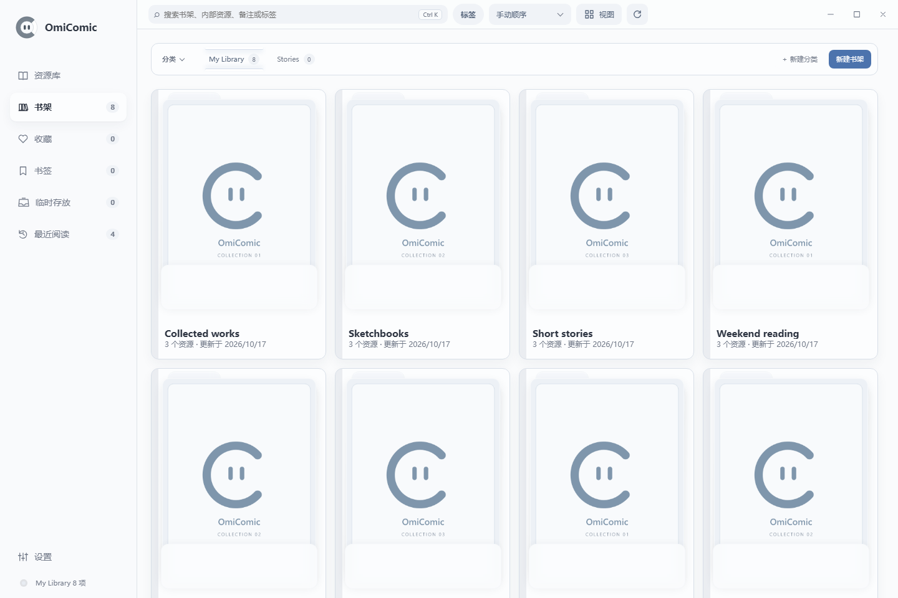</a>
</td>
<td width="50%" valign="top">
<h3>阅读器</h3>

支持双页、适应窗口、全景和沉浸阅读。通过底部进度条跳页，实时调整亮度、对比度和图像效果。

<a href="docs/images/v1.1.36/windows-reader.png">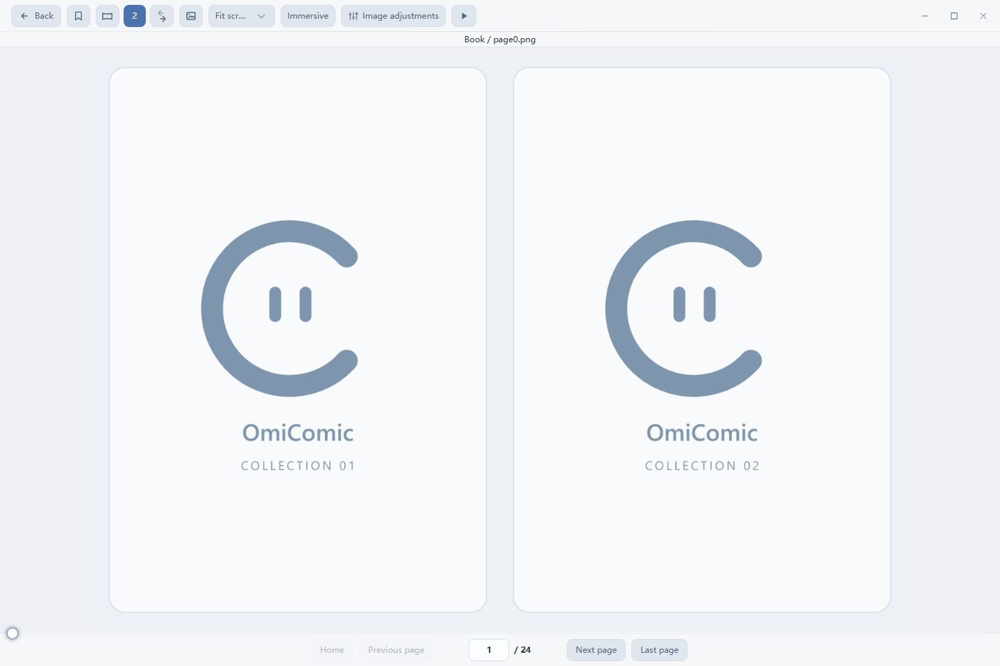</a>
</td>
</tr>
</table>

展开 Windows 详细介绍：资源库、标签、预览与设置

<table>
<tr>
<td width="50%" valign="top">
<h3>首页</h3>

最近阅读集中展示封面、页码和进度。双击封面，或点击悬停时出现的“继续阅读”，回到上次读到的位置。

<a href="docs/images/v1.1.40/windows-home.png">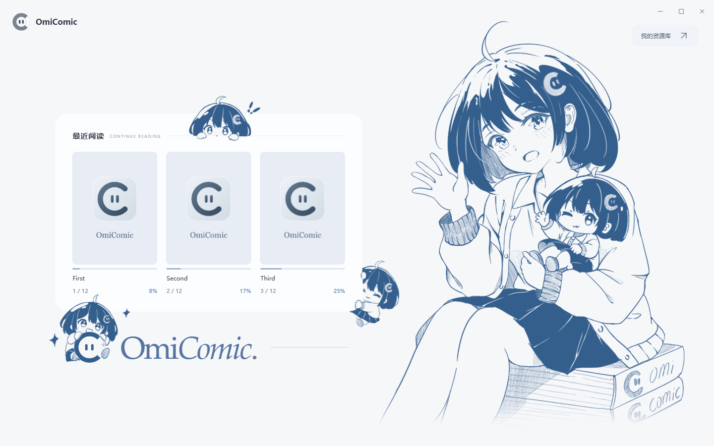</a>
</td>
<td width="50%" valign="top">
<h3>资源库</h3>

添加多个漫画目录，以封面网格或列表浏览；通过名称、标签和简介查找资源。

<a href="docs/images/v1.1.36/windows-library.png">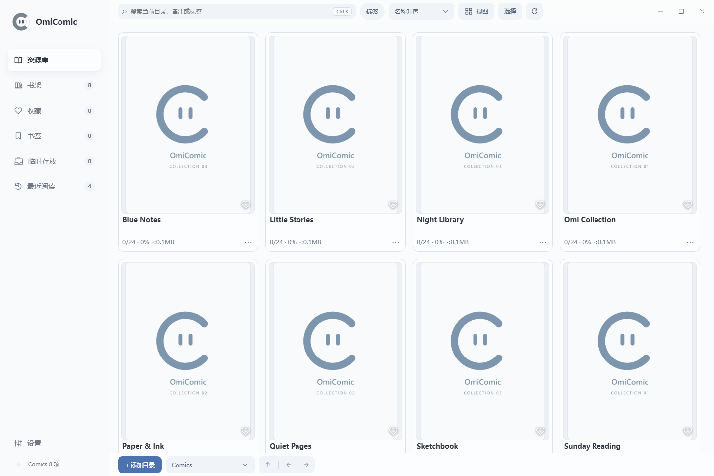</a>
</td>
</tr>
<tr>
<td width="50%" valign="top">
<h3>标签筛选</h3>

按模糊或精准匹配筛选标签，在同一面板中管理和清理标签。

<a href="docs/images/v1.1.36/windows-tags.png">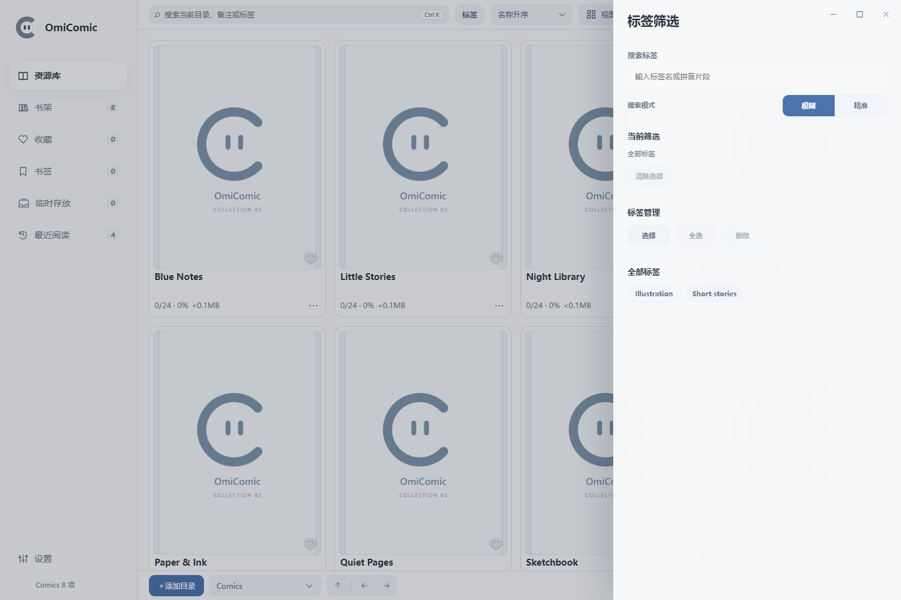</a>
</td>
<td width="50%" valign="top">
<h3>详情与页面预览</h3>

查看封面、进度、标签和简介，通过缩略图浏览整本漫画。双击简介编辑，双击缩略图从对应页开始阅读。

<a href="docs/images/v1.1.36/windows-detail.png">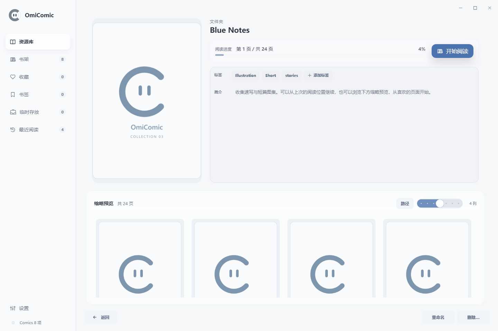</a>
</td>
</tr>
<tr>
<td width="50%" valign="top">
<h3>设置</h3>

调整主题、字号、阅读方式、图片缓存与预加载；可开启系统主题跟随。

<a href="docs/images/v1.1.36/windows-settings.png">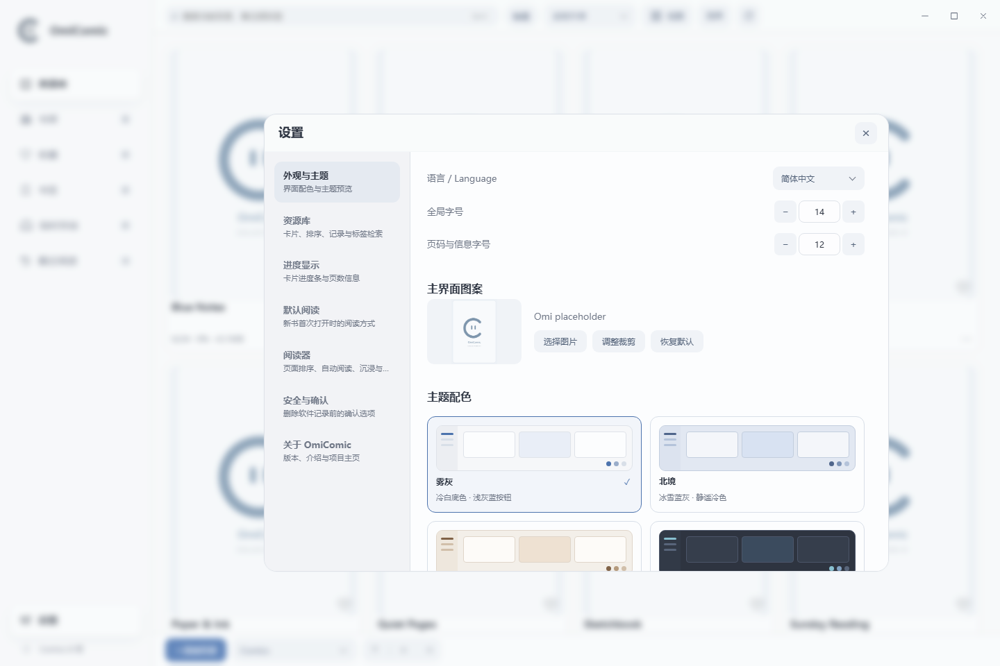</a>
</td>
<td width="50%" valign="top">
<h3>关于 OmiComic</h3>

查看版本与项目主页，打开内置操作说明。按分类折叠、目录跳转或离线搜索，快速查找按钮、快捷键和手机手势。

</td>
</tr>
</table>

## macOS

支持 Apple Silicon（M 系列，arm64）与 Intel（x64）。解压 ZIP 后将 OmiComic 拖入“应用程序”。提供与 Windows 相同的本地格式、书架、标签和阅读工具，支持原生窗口按钮、Command 快捷键及关闭窗口后从 Dock 重新打开。

当前发行包没有 Apple 开发者签名与公证。首次打开的处理方式见 [Mac 安装说明](docs/APPLE.md)；内置操作说明可切换到 macOS，查看安装、⌘＋K 搜索、⌘＋滚轮缩放和窗口操作。

## Android 版

以触摸操作为中心，从目录浏览到全屏阅读，一只手也能轻松切换。

<table>
<tr>
<td width="50%" valign="top">
<h3>书架</h3>

按阅读计划把漫画放进不同书架。长按选择、调整顺序，分类管理不同收藏。

</td>
<td width="50%" valign="top">
<h3>阅读器</h3>

点击画面中央唤出工具，支持滑动翻页、双指缩放、音量键翻页和自动阅读。

<a href="docs/images/v1.1.36/android-reader.png">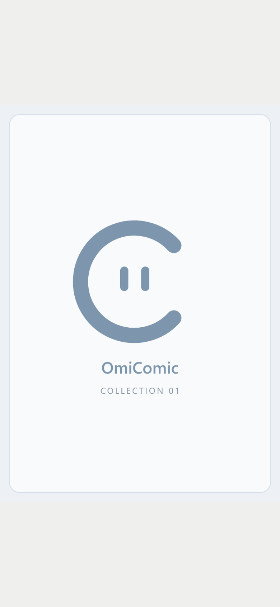</a>
</td>
</tr>
</table>

展开 Android 详细介绍：目录、预览与设置

<table>
<tr>
<td width="50%" valign="top">
<h3>首页</h3>

最近阅读显示封面与进度，轻点即可续读；底部可直接进入资源库和设置。

<a href="docs/images/v1.1.36/android-home.png">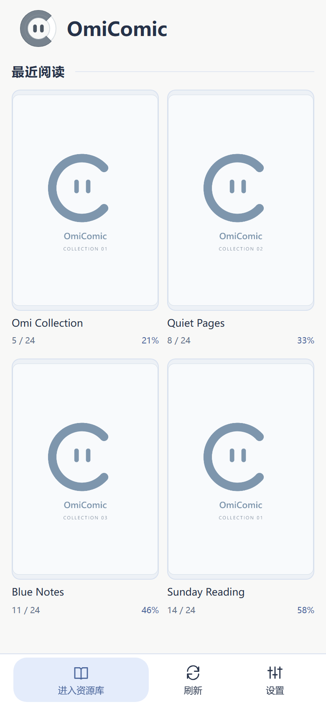</a>
</td>
<td width="50%" valign="top">
<h3>资源库</h3>

底栏切换资源库、书架、收藏、书签和最近阅读。网格或列表布局可按栏目分别设置。

</td>
</tr>
<tr>
<td width="50%" valign="top">
<h3>目录浏览</h3>

从侧边目录树进入漫画所在的文件夹，也可添加目录或打开单个文件。

<a href="docs/images/v1.1.36/android-folders.png">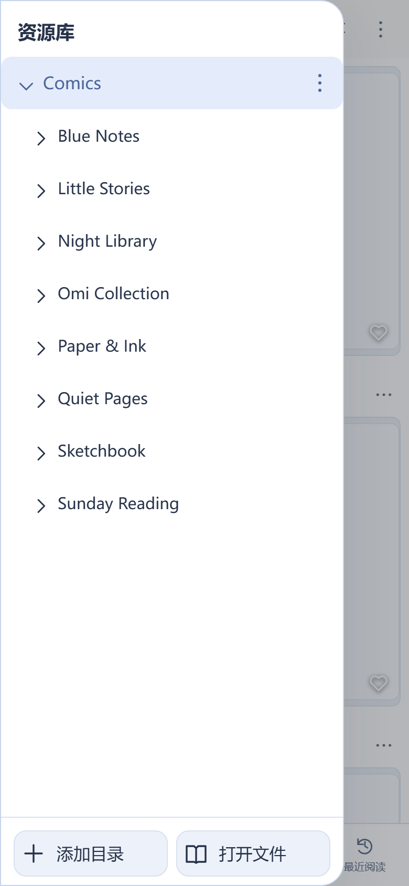</a>
</td>
<td width="50%" valign="top">
<h3>漫画详情</h3>

查看封面、标签、简介和页面预览，从需要的页面开始阅读。

<a href="docs/images/v1.1.36/android-detail.png">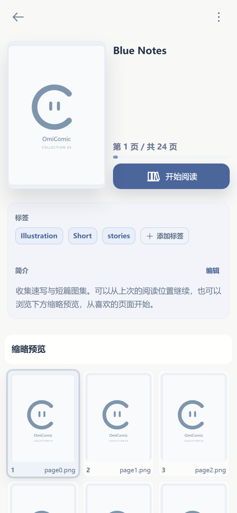</a>
</td>
</tr>
<tr>
<td width="50%" valign="top">
<h3>设置</h3>

各栏目分别保存显示布局，还可调整语言、主题、阅读方式和缓存容量。

<a href="docs/images/v1.1.36/android-settings.png">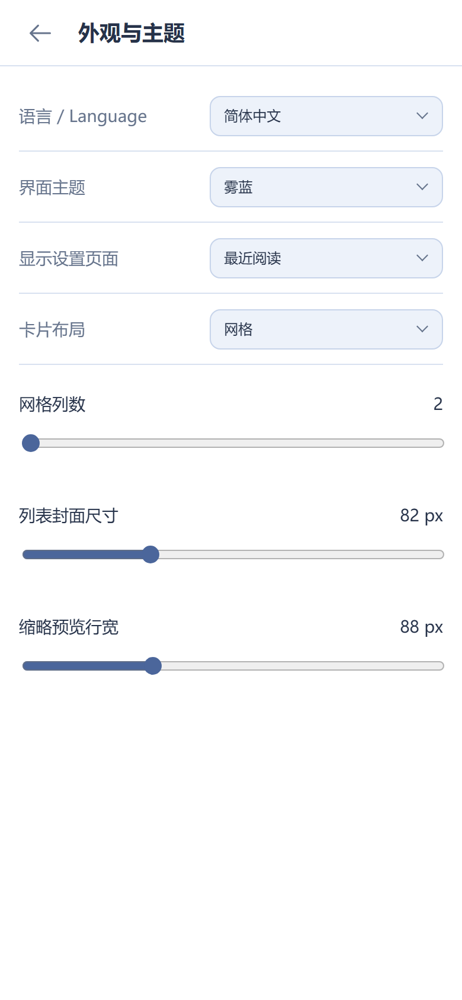</a>
</td>
<td width="50%" valign="top">
<h3>关于 OmiComic</h3>

查看应用介绍、版本与 GitHub 项目主页。

<a href="docs/images/v1.1.36/android-about.png">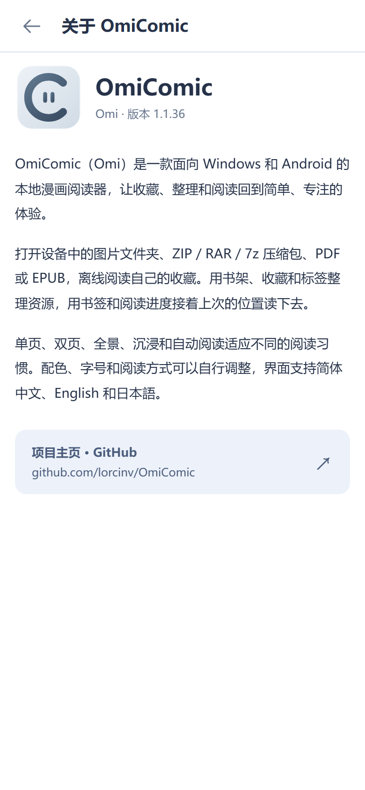</a>
</td>
</tr>
</table>

## [支持作者](docs/support.md)

如果你觉得软件对你有帮助，可以支持一下作者，这会对作者有很大的鼓励ヽ(✿ﾟ▽ﾟ)ノ

## 更多

[使用方法](docs/USER_GUIDE.zh-CN.md) · [版本更新](CHANGELOG.md) · [反馈问题](https://github.com/lorcinv/OmiComic/issues) · [历史版本](docs/releases/README.md)

## 开源许可证

OmiComic 的自有程序代码采用 **GNU 通用公共许可证第 3 版（GPL-3.0-only）** 授权，详见 [LICENSE](LICENSE)。第三方组件保留各自许可；旧版首页插画的来源与未核实授权状态单独列于 [素材来源](ASSET_CREDITS.md)，1.1.40 起不再收录该图。
