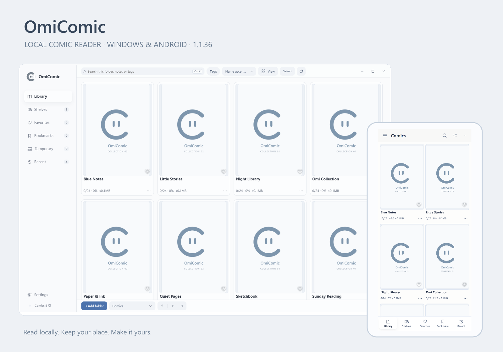

<div align="center">


# OmiComic

本地漫画阅读器 · Local comic reader · ローカル漫画リーダー

**Windows x64 · Android 8.0+ · 1.1.36**

[下载 / Download / ダウンロード](https://github.com/lorcinv/OmiComic/releases/tag/v1.1.36) · [简体中文](#简体中文) · [English](#english) · [日本語](#日本語)

</div>



| 平台 / Platform / 対応環境 | 下载 / Download / ダウンロード |
| --- | --- |
| Windows x64 | [OmiComic-Portable-1.1.36-x64.zip](https://github.com/lorcinv/OmiComic/releases/download/v1.1.36/OmiComic-Portable-1.1.36-x64.zip) |
| Android 8.0+ | [OmiComic-1.1.36-android.apk](https://github.com/lorcinv/OmiComic/releases/download/v1.1.36/OmiComic-1.1.36-android.apk) |
| SHA-256 | [SHA256SUMS-1.1.36.txt](https://github.com/lorcinv/OmiComic/releases/download/v1.1.36/SHA256SUMS-1.1.36.txt) |

## 简体中文

OmiComic（Omi）是一款面向 Windows 和 Android 的本地漫画阅读器。打开自己的收藏，用书架、收藏和标签整理资源，再从上次的位置接着读。

- 支持图片文件夹、单张图片、ZIP／CBZ、RAR／CBR、7z／CB7、PDF 和 EPUB。
- 提供单页、双页、全景、沉浸与自动阅读，保留阅读进度和书签。
- 支持多目录、搜索、标签、简介、收藏和书架；Android 使用系统目录授权读取文件。
- 可切换雾灰、北境、暖沙和夜色主题，界面支持简体中文、English、日本語。
- Windows 提供首页图案裁剪预览、全局字号、按电脑配置分配的图片缓存和预读；Android 提供触摸、双指缩放和音量键翻页。

**1.1.36 更新：** PC 设置新增“关于 OmiComic”。手机和 PC 共用 Omi 介绍、版本和 GitHub 项目链接。Windows 包含此前的主题统一、详情简介双击编辑并自动保存、缩略图双击阅读和大图加载优化；Android 保留目录授权、原生图片显示、独立栏目布局及后台恢复修复。

Windows：完整解压 ZIP 后运行 `OmiComic.exe`，保留同目录的运行文件。Android：安装 APK；沿用原签名，可覆盖升级保留设置、目录授权和记录。升级前可自行备份重要数据，卸载 Android 应用会清除应用记录。

漫画在本机读取。删除软件内引用和删除原文件是两种操作；重命名或明确选择删除原文件会修改本地文件。EPUB 不支持 DRM、远程或交互内容；密码保护和多卷压缩包不支持。

[使用方法](README_使用方法.md) · [Android 说明](docs/ANDROID.md) · [版本更新](CHANGELOG.md) · [1.1.36 验证记录](docs/verification-1.1.36.md)

## English

OmiComic (Omi) is a local comic reader for Windows and Android. Open your collection, organize it with bookshelves, favorites and tags, and continue from where you left off.

- Read image folders, individual images, ZIP/CBZ, RAR/CBR, 7z/CB7, PDF and EPUB.
- Choose single-page, double-page, panorama, immersive or automatic reading, with saved progress and bookmarks.
- Manage multiple folders, search, tags, descriptions, favorites and bookshelves. Android uses system folder permissions.
- Choose Mist, Nord, Sand or Night, with Simplified Chinese, English and Japanese interfaces.
- Windows offers cropped home artwork, global text sizing and hardware-aware image caching and preloading. Android supports touch gestures, pinch zoom and volume-key navigation.

**New in 1.1.36:** About OmiComic is now available in PC settings. Both platforms share the introduction, version and GitHub project link. Windows also includes the recent theme refinements, double-click description editing with automatic saving, double-click thumbnail reading and large-image loading improvements. Android retains folder permissions, native image rendering, independent view layouts and background-resume fixes.

Windows: extract the entire ZIP and run `OmiComic.exe`, keeping its companion files. Android: install the APK. It uses the existing signing certificate, so an in-place upgrade retains settings, folder permissions and reading records. Uninstalling the Android app clears its app data.

Books are read locally. Removing an app reference is separate from deleting the original file; renaming or explicitly deleting an original changes the local file. EPUB does not support DRM, remote or interactive content. Password-protected and multi-volume archives are unsupported.

[Release notes](https://github.com/lorcinv/OmiComic/releases/tag/v1.1.36) · [Verification](docs/verification-1.1.36.md) · [Build instructions](docs/ANDROID.md)

## 日本語

OmiComic（Omi）は Windows と Android 向けのローカル漫画リーダーです。自分のコレクションを開き、本棚・お気に入り・タグで整理して、前回の続きから読めます。

- 画像フォルダー、単一画像、ZIP／CBZ、RAR／CBR、7z／CB7、PDF、EPUB に対応。
- 単ページ、見開き、パノラマ、没入、自動読書を選択でき、読書進捗としおりを保存します。
- 複数フォルダー、検索、タグ、紹介文、お気に入り、本棚で整理。Android はシステムのフォルダーアクセス権を使用します。
- 霧グレー・北欧・暖砂・夜色のテーマを用意。UI は簡体字中国語、English、日本語に対応しています。
- Windows ではホーム画像のトリミング、全体の文字サイズ、PC の性能に応じた画像キャッシュと先読みを設定できます。Android はタッチ操作、ピンチズーム、音量キーでのページ送りに対応します。

**1.1.36 の更新：** PC の設定に「OmiComic について」を追加しました。両プラットフォームで紹介文、バージョン、GitHub リンクを統一しています。Windows にはテーマの調整、紹介文のダブルクリック編集と自動保存、サムネイルのダブルクリック読書、大画像の読み込み改善も含まれます。Android はフォルダー権限、ネイティブ画像表示、画面ごとのレイアウト、バックグラウンド復帰の修正を引き継いでいます。

Windows は ZIP をすべて展開し、同じフォルダーのファイルを残したまま `OmiComic.exe` を起動してください。Android は APK をインストールします。従来と同じ署名で、設定・フォルダー権限・読書記録を保った上書き更新が可能です。Android アプリをアンインストールするとアプリ内の記録は削除されます。

作品は端末内で読み込みます。アプリ内の参照の削除と元ファイルの削除は別の操作です。元ファイルの名前変更や明示的な削除は端末内のファイルを変更します。EPUB の DRM・リモート・対話型コンテンツ、暗号化された書庫、分割書庫には対応していません。

[リリースノート](https://github.com/lorcinv/OmiComic/releases/tag/v1.1.36) · [検証記録](docs/verification-1.1.36.md) · [ビルド手順](docs/ANDROID.md)

## Screenshots / 界面 / 画面

All covers, pages and home artwork shown here use synthetic Omi symbol placeholders. 配图中的封面、页面和首页图案全部使用 Omi 占位符号。画像内の表紙・ページ・ホーム画像はすべて Omi のプレースホルダーです。


  

## Build / 构建 / ビルド

Node.js 24 + npm. Windows packaging requires Windows x64. Android requires JDK 17+, Android platform 35 and build-tools 35.0.0.

```sh
npm ci
npm run dev
npm run verify
npm run dist:portable
npm run dist:android
```

Third-party notices are included in the distributions. [7-Zip source](https://github.com/lorcinv/OmiComic/releases/download/v1.1.36/7z2604-src.tar.xz) · [Archive limits](tests/ARCHIVE_STRESS.md)

本项目暂未提供开源许可证。No open-source license has been granted for this project. 本プロジェクトにはオープンソースライセンスが付与されていません。
